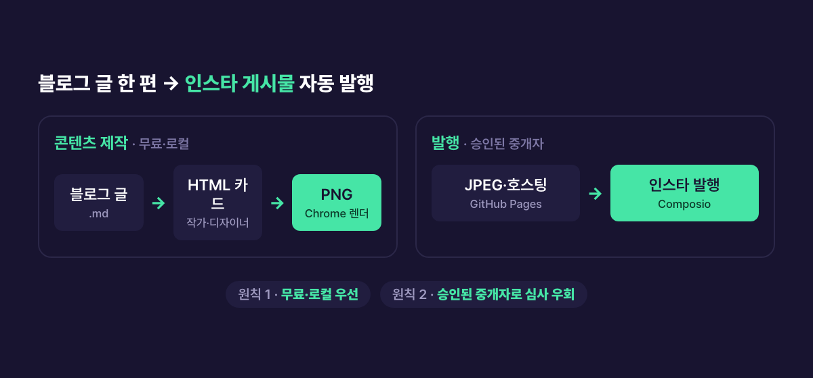
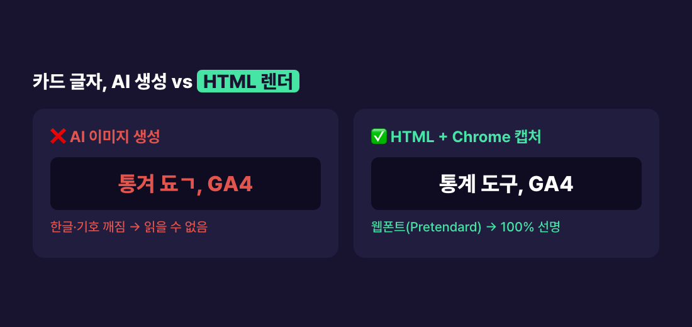

> **🗺 시리즈: 블로그 → 인스타 자동화** — 지금은 **① 설계와 카드 생성**
>
> **①** 설계와 카드 생성 *(현재 글)* · ② 디자인 · ③ 발행 · ④ DM의 벽
{: .prompt-info }

## 문제 — 글 한 편을 두 번 만들고 있었다

블로그에 글을 하나 올리면, 인스타그램에는 같은 내용을 **카드뉴스로 다시** 만들어야 했다. 글은 텍스트이고 인스타는 이미지다. 그래서 매번 다섯 단계를 손으로 반복했다.

1. 글을 카드 분량으로 요약하고 쪼갠다
2. 카드 디자인을 잡는다
3. 6~10장을 편집한다
4. 캡션과 해시태그를 쓴다
5. 올린다

글 한 편에 30분에서 1시간이 더 붙었다. 손으로 만들다 보니 카드마다 디자인이 들쭉날쭉해서 피드를 모아 보면 한 사람이 만든 것 같지도 않았다. 목표는 하나였다. **블로그 글 하나를 넣으면 인스타 게시물 하나가 나오게** 만든다.

## 자동화를 막는 세 개의 벽

"귀찮다"가 아니라 구조적으로 막는 지점이 셋 있었다.

1. **포맷 불일치** — 긴 텍스트를 6장짜리 이미지로 바꿔야 한다. 요약과 쪼개기가 필요하다.
2. **카드의 글자** — "이미지니까 AI로 만들면 되지" 했더니 한글이 깨졌다. 이 글의 본론이다.
3. **발행 API의 장벽** — 인스타 자동 게시는 API 권한 심사가 필요하고, 일부 기능은 사업자등록까지 요구한다. *(→ [③ 발행](/posts/blog-to-instagram-automation-4-publish/), [④ DM의 벽](/posts/blog-to-instagram-automation-5-dm-wall/))*

## 전체 설계 — 두 가지 원칙


_글 → HTML 카드 → PNG 렌더 → JPEG 변환 → 공개 URL 호스팅 → 발행._

전체를 관통한 원칙은 둘이었다.

- **원칙 1 · 무료·로컬 우선** — 렌더링과 이미지 생성은 과금 없이 내 맥에서 처리한다.
- **원칙 2 · 승인된 중개자 활용** — 발행 API 심사를 직접 받는 대신, 이미 승인된 인프라에 올라탄다.

이 원칙대로 파이프라인을 **Claude Code 스킬 하나**로 묶었다. 스킬은 설정 파일 다섯 개와 렌더 스크립트로 구성된다.

| 파일 | 역할 |
|---|---|
| `brand.md` | 계정 핸들, 브랜드 색, 서체 — 카드에 찍히는 값의 정본 |
| `copy-rules.md` | 카드 문구 규칙 (한 장 한 메시지, 금지 표현 목록) |
| `image-direction.md` | 어떤 카드에 이미지를 쓰고 어디서 가져올지 |
| `caption-hashtag.md` | 캡션 구조와 해시태그 규칙 |
| `template.html` | 카드 HTML 템플릿 |
| `render.mjs` | 슬라이드 JSON을 템플릿에 넣어 PNG로 찍는 스크립트 |

설정을 파일로 뺀 이유는 **한 번 정한 걸 다시 정하지 않기 위해서**다. 카드를 만들 때마다 "강조색이 뭐였지", "해시태그 몇 개였지"를 다시 정하면 그게 곧 들쭉날쭉의 원인이 된다.

카드에 무엇을 담을지도 이때 정했다. **카드는 큰 맥락만**(문제와 핵심 해결까지) 담고, 구체적인 방법·코드·수치는 넣지 않는다. 그건 블로그 본문으로 넘긴다. 카드가 본문을 다 대신하면 블로그로 올 이유가 사라진다.

## 카드의 글자 문제 — AI가 그리면 깨진다

처음엔 "어차피 이미지니까 AI로 카드를 통째로 생성하면 되겠지" 했다. 결과는 **글자가 깨진** 카드였다. 제목도 본문도 알아볼 수 없게 뭉개졌다.



이미지 생성 모델(FLUX 등)은 픽셀을 "그리는" 방식이라 정확한 글자 형태를 만들지 못한다. 영문도 자주 깨지고 **한글은 더 심하다**. 받침과 겹자음이 있는 글자가 특히 뭉개진다. 카드뉴스의 핵심은 "읽히는 텍스트"인데, 그게 깨지면 카드가 쓸모없다.

## 해결 — 텍스트는 HTML로 그리고 Chrome으로 캡처

카드를 *이미지 생성*이 아니라 **웹페이지 렌더링**으로 만든다.

1. HTML/CSS로 카드 한 장을 **1080×1350**(인스타 세로 4:5)으로 디자인한다. 텍스트는 웹폰트라 선명하다.
2. 슬라이드 내용을 JSON으로 만들어 템플릿에 주입한다.
3. **Chrome 헤드리스로 스크린샷**을 찍어 PNG로 만든다.
4. 한글은 **Pretendard** 웹폰트로 통일한다.
5. 배경 일러스트가 필요할 때만 로컬 FLUX로 만든다. 이때는 "글자 없는 그림"만 요청한다.

```bash
chrome --headless --window-size=1080,1350 \
  --virtual-time-budget=3000 \
  --screenshot=slide.png "file://card.html"
```

슬라이드 JSON은 이런 모양이다. 타입(표지·본문·목록·CTA)별로 템플릿이 다르게 그린다.

```json
{
  "type": "list",
  "kicker": "비교 · 세 도구",
  "title": "어디에 *무엇을* 쓰나",
  "items": ["GA4 · 행동·수익 분석", "Search Console · 검색 노출"],
  "take": "목적이 다르면 둘 다 필요하다"
}
```

`*별표*`로 감싼 단어는 형광펜 강조로, `take`는 카드 맨 아래 한 줄 결론으로 렌더된다. 결과적으로 블로그 글 한 편이 **글자 하나 안 깨진 카드 6장 PNG**로 나온다.

## 실제로 밟은 함정 네 가지

### 1) 폰트가 적용되기 전에 캡처된다

`--virtual-time-budget`을 주지 않으면 **웹폰트가 로드되기 전에 스크린샷**이 찍힌다. HTML로 그렸는데도 글자가 기본 폰트로 나오거나 어색하면 십중팔구 이것이다. 3000ms 정도면 충분했다.

### 2) 제목이 길면 박스를 넘는다

카드 폭은 1080px로 고정이라 제목이 길면 박스를 넘친다. 요약으로 욱여넣지 말고 **다음 슬라이드로 넘기는 규칙**을 두면 레이아웃이 안 깨진다. 글자 수 상한도 정해 뒀다(제목 28자, 본문 35자, 목록 항목 20자). 두 줄로 끊고 싶은 위치가 있으면 제목에 `\n`을 넣어 직접 정한다.

### 3) 목록 항목의 `·`는 하나만

목록 카드는 항목 안의 `·`를 기준으로 왼쪽(굵게)과 오른쪽(보조 설명)을 나눈다. 템플릿은 **첫 번째 `·`에서만** 자르고, 나머지 `·`는 오른쪽 설명에 그대로 둔다. 그래서 `GA4 · 행동·수익 분석`은 의도대로 "GA4 / 행동·수익 분석"이 된다.

문제는 왼쪽 라벨에 `·`가 들어갈 때다. 라벨을 "검색·노출"처럼 쓰면 라벨이 반으로 잘린다. 사람이 쓰는 문장에는 가운뎃점이 생각보다 자주 나와서, 문구를 쓸 때 "항목당 구분용 `·`는 하나, 라벨에는 쓰지 않는다"를 규칙으로 적어 뒀다.

### 4) 경로의 `#`이 `file://`을 깨뜨린다

내 작업 폴더 이름에 `#`이 들어 있다. 브라우저는 `file://` 주소에서 `#` 뒤를 **페이지 안 위치(앵커)**로 해석한다. 그래서 그 폴더의 배경 이미지를 `file://`로 불러오면 경로가 중간에 잘려 이미지가 안 뜬다. 에러도 없이 빈 배경으로 나온다. 렌더 전에 이미지를 `#` 없는 임시 폴더로 복사해서 피했다. 근본 해결은 경로를 URL 인코딩(`#` → `%23`)하는 것이다.

## 표지는 블로그 커버 일러스트를 재사용한다

처음엔 인스타 표지를 글자만 있는 단색 타이포 카드로 만들어 1·2편을 올렸다. 올려 놓고 보니 원했던 표지가 아니었다. 글자만 있는 표지는 피드에서 무슨 글인지 그림으로 구분되지 않는다. 그래서 **블로그 메인 카드용으로 이미 만든 FLUX 일러스트**를 인스타 표지 배경으로 재사용하게 바꿨다. 일러스트 원본을 한 폴더(`covers/_src/<slug>.png`)에 두고 블로그 커버와 인스타 표지가 같이 가져다 쓴다.

같은 그림을 두 번 만들지 않으니 비용이 줄고, 블로그와 인스타가 같은 글이라는 게 한눈에 보인다. 다만 블로그 커버는 카테고리 색으로, 인스타 표지는 인스타 브랜드 색으로 합성을 따로 한다. 채널마다 톤이 다르기 때문이다.

## 사용한 기술

- **Claude Code 커스텀 스킬** — 글→카드→발행 절차와 설정 파일 다섯 개를 하나로 묶음
- **Chrome 헤드리스 `--screenshot`** — 이미 깔려 있는 무료 렌더 엔진
- **HTML/CSS 템플릿**(데이터 주입식) · **Pretendard**(한글) · **Node.js**(반복 렌더)
- **로컬 FLUX** — 글자 없는 배경 일러스트만

> **🧭 기획자·사업자라면**
> - **AI가 잘하는 일과 못하는 일을 나눠 배치하라.** 배경 그림은 AI에게, 정확해야 하는 텍스트는 HTML에게. "AI가 다 해준다"로 맡기면 품질이 가장 약한 고리에서 결정된다.
> - **템플릿 1개 + 자동 렌더면 한계비용이 0에 가까워진다.** 카드 외주나 디자인 툴 구독 대신 이 구조를 만들면, 글이 늘수록 이득이 커진다. 초기 구축 시간과 "글당 30~60분 × 글 수"를 비교해 판단한다.
> - **카드와 본문의 역할을 먼저 정하라.** 카드가 모든 걸 말하면 본문으로 올 이유가 없다. 채널마다 "여기서는 어디까지"를 정하는 게 콘텐츠 기획의 첫 단추다.
{: .prompt-tip }

## 정리

- 블로그→인스타의 병목은 "한 번 더 만들기"다. 설정을 파일로 고정한 스킬 하나로 없앴다.
- 카드의 글자는 AI 이미지 생성으로 넣지 마라. HTML로 그리고 Chrome 헤드리스로 캡처하면 무료이고 선명하다.
- 폰트 로딩 대기, 제목 분리, 가운뎃점 규칙, 경로의 `#` — 이 넷만 챙기면 레이아웃이 안 깨진다.

### 시리즈 목차

1. **전체 설계와 카드뉴스 자동 생성** (현재 글)
2. [벤치마킹 vs 카피, 그리고 반응 0에서 바꾼 표지](/posts/blog-to-instagram-automation-3-design/)
3. [Instagram API 심사 없이 자동 발행](/posts/blog-to-instagram-automation-4-publish/)
4. [사업자 없으면 DM 자동화 못 한다](/posts/blog-to-instagram-automation-5-dm-wall/)
