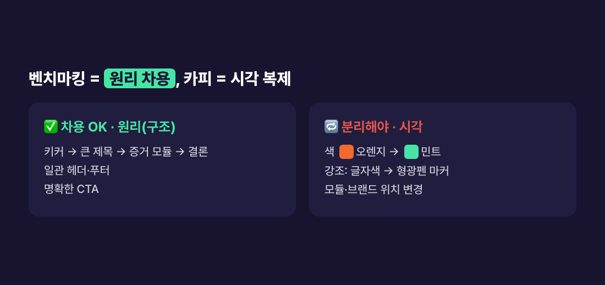

> **🗺 시리즈: 블로그 → 인스타 자동화** — 지금은 **② 디자인**
>
> ← 이전 편: [(1) 전체 설계와 카드뉴스 자동 생성](/posts/blog-to-instagram-automation-2-card-generation/)
>
> ① 설계와 카드 생성 · **②** 디자인 *(현재 글)* · ③ 발행 · ④ DM의 벽
{: .prompt-info }

## 문제 — 따라 하고 싶은데, 어디까지 따라 해도 되나

카드를 자동으로 찍어내는 건 [1편](/posts/blog-to-instagram-automation-2-card-generation/)에서 해결했다. 남은 건 "어떤 카드를 찍어낼 것인가"였다.

잘되는 인스타 카드 계정을 보면 "이렇게 만들고 싶다" 싶다. 그런데 **그대로 따라 만들면 짝퉁**이고, 남의 사진이나 밈을 가져다 쓰면 저작권 문제다. 참고는 하고 싶은데 어디까지가 허용이고 어디부터가 베끼기일까?

그리고 이 글에는 두 번째 문제가 있다. 디자인을 다 정하고 카드를 아홉 번 올렸는데, **좋아요도 댓글도 0이었다.** 디자인이 문제인 줄 알았는데 원인은 다른 데 있었다.

## 벤치마킹과 카피는 다르다

잘되는 카드의 **작동 원리(구조)**는 보편적인 문법이라 배워도 된다.

- 키커(작은 라벨) → 큰 제목(핵심어 강조) → 증거 모듈 → 한 줄 결론
- 모든 카드에 같은 헤더·푸터
- 명확한 행동 유도(CTA)

이건 누구의 소유도 아니다. 신문 기사의 "제목 → 리드 → 본문" 구조를 아무도 소유하지 않는 것과 같다.

문제는 **시각 정체성**까지 가져올 때다. 색 조합, 레이아웃, 강조 방식을 그대로 복제하면 카피다. 남의 인물 사진이나 밈은 저작권·초상권 리스크까지 생긴다.

## 원리는 차용하고 시각은 분리했다

참고한 계정은 **다크 배경 + 오렌지** 톤에 상단 바가 있는 구조였다. 구조만 가져오고 시각 요소는 하나씩 바꿨다.

| 요소 | 참고한 계정 | 내 것 |
|---|---|---|
| 색 | 다크 + 오렌지 | **딥 인디고 + 민트** |
| 강조 | 글자색 변경 | **형광펜 마커**(배경 스와이프) |
| 정보 모듈 | 둥근 박스 | **왼쪽 액센트 라인 카드** |
| 브랜드 위치 | 상단 바 | **하단 푸터** |

여기에 UX 라이팅 원칙을 더했다. **한 카드에 한 메시지**, 누구를 위한 카드인지 명시("○○라면 이 글이 당신 얘기"), 전문 용어는 풀어 쓰기. 이미지는 직접 만든 일러스트와 캡처만 쓰고 남의 사진과 밈은 뺐다.

### 두 번째 벤치마킹 — 단계형 카드 템플릿

나중에 다른 계정에서 눈에 띄는 카드를 하나 더 봤다. 위쪽에 카테고리 탭이 있고, 아이콘·번호가 붙은 목록의 테두리가 위에서 아래로 차례차례 그려지는 애니메이션 카드였다.

이번에도 같은 원칙으로 갔다. "번호 목록 + 테두리가 순서대로 그려지는 동작"이라는 **원리**만 가져오고, 색·서체·아이콘은 전부 내 것으로 바꿨다. 아이콘 자리에는 이모지 대신 직접 만든 마스코트(터미널 커서 얼굴을 한 민트색 블롭)를 넣었다.

이 템플릿은 기존 카드를 **갈아엎지 않고 옆에 추가**했다. 5~6단계로 쌓이는 내용(파이프라인, 체크리스트)이면 단계형 카드를, 비교나 결론이면 기존 카드를 쓴다. 고르는 기준은 문구 규칙 파일에 표로 적어 뒀다.

## 반응 0 — 디자인이 아니라 표지 문장이 문제였다

디자인을 정하고 카드를 계속 올렸다. 아홉 번째 게시물까지 **좋아요·댓글이 하나도 없었다.**

처음엔 디자인을 의심했다. 하지만 카드를 한 줄로 늘어놓고 보니 공통점이 보였다. 표지(1번 카드)에 **내가 겪은 사건**이 올라가 있었다. 예를 들어 블로그 자동화 글의 표지 초안은 "자동화가 이틀 연속 죽었다"였다.

이유는 카드 자동화의 출발점에 있었다. 문구 규칙이 "블로그 글의 구조(문제 → 원인 → 해결)를 카드로 옮긴다"였다. 블로그 글은 문제, 즉 내가 겪은 사고로 시작한다. 그래서 그 사고가 그대로 표지가 됐다.

블로그 독자는 같은 문제를 **검색해서** 들어온다. 그래서 "이틀 연속 죽었다"가 오히려 반갑다. 인스타 독자는 **스크롤하다가** 만난다. 모르는 사람이 겪은 사고는 그냥 지나친다.

### 방송 예고와 유튜브 썸네일은 무엇을 앞세우나

방송 예고, 광고 헤드라인, 유튜브 썸네일은 전부 **보는 사람이 얻는 것**을 앞세운다. 만든 사람의 고생을 앞세우지 않는다. 카드 표지도 같아야 했다.

| ✗ 내 사건 (금지) | ✓ 독자가 얻는 것 (정답) |
|---|---|
| "자동화가 이틀 연속 죽었다" | "매일 블로그 1편, **손 안 대고** 씁니다" |
| "로그는 성공인데 글이 틀어졌다" | "네이버 자동 발행, **API 없이** 됩니다" |
| "3주간 검증이 수익을 지웠다" | "백테스트 수익률, **그대로 믿으면 안 되는 이유**" |

반응이 많은 카드 계정 몇 곳의 표지도 실제로 모아 봤다. 공통점은 셋이었다.

1. 헤드라인이 **이득이나 비용 제거**("무료", "풀었다", "아무도 모르는")다. 실패담으로 시작하는 표지는 하나도 없었다.
2. 표지 그림이 **실제 화면 캡처나 실사**다. 추상적인 플랫 일러스트는 없었다.
3. 위에 작은 소제목, 아래에 큰 헤드라인 두 줄.

그래서 표지 공식을 다섯 개로 정리해 규칙 파일에 넣었다.

1. **결과 + 반전** — "매일 블로그 1편, 손 안 대고" + "네이버는 API도 없는데"
2. **가능해?** — "AI가 내 목소리로 읽어준다고?"
3. **숫자** — "월 5만 원 내던 걸 공짜로"
4. **비용·장벽 제거** — "심사 없이", "무료로", "코딩 몰라도"
5. **손실 회피** — "이거 모르면 돈 날린다"

실패담은 버리지 않았다. **3~6번 카드로 옮겨 신뢰 장치로** 쓴다. "단, 여기 함정이 있다" 식이다. 실패는 결과를 믿게 만드는 *증거*이지 사람을 멈추게 하는 *훅*이 아니다.

표지 문장을 확정하기 전에는 세 가지를 묻는다. 이 문장이 남의 일이 아니라 내 일로 읽히나? 팔로워가 아닌 사람이 봐도 걸리나? 유튜브 썸네일로 써도 클릭할 만한가? 하나라도 아니면 다시 쓴다.

### 이미지 정책도 같이 바꿨다

처음 정책은 "이미지는 표지에만, 본문 카드는 글자와 모듈로"였다. 글자가 묻히지 않게 하려는 것이었다. 그런데 반응 좋은 계정들은 핵심 카드 몇 장에 실제 화면을 넣고 있었다.

- 이미지는 **표지 + 핵심 카드 2~3장**까지 쓴다. 모든 카드에 깔면 글자가 묻히니 거기까지만이다.
- 나머지 카드는 **모듈을 바꿔 가며** 화면에 변화를 준다(단계형, 좌우 비교, 목록, 결론 블록). **같은 모듈은 세 장 연속으로 쓰지 않는다.**
- 표지 그림은 가능하면 **실제 화면**으로 만든다. 예를 들어 블로그 자동화 글은 실제 실행 로그를 터미널 화면으로 재구성해 표지로 썼다. 개인정보가 찍히는 화면은 쓰지 않았다.

## 사용한 기술

- **HTML/CSS 카드 디자인 시스템** — 단일 강조색, 다크 인디고 테마, 형광펜 마커, 왼쪽 액센트 모듈
- **단계형 카드 템플릿** — 정지 PNG 또는 테두리가 그려지는 애니메이션 mp4로 렌더
- **문구 규칙 파일** — 표지 공식 5개, 금지 표현, 모듈 선택표를 파일로 고정

> **🧭 기획자·사업자라면**
> - **벤치마킹의 안전선은 "원리는 차용, 표현은 분리"다.** 구조와 전략은 배워도 되지만 시각 자산이나 이미지를 복제하면 법적 리스크(저작권·초상권)가 생긴다.
> - **채널마다 첫 문장의 문법이 다르다.** 검색으로 오는 독자에게는 문제가 훅이지만, 스크롤로 만나는 독자에게는 이득이 훅이다. 같은 콘텐츠를 다른 채널로 옮길 때 구조를 그대로 옮기면 첫 문장부터 틀린다.
> - **반응 0이면 디자인보다 첫 문장을 먼저 의심하라.** 디자인을 바꾸는 데는 며칠이 들지만, 표지 문장을 바꾸는 데는 몇 분이면 된다. 싼 가설부터 검증한다.
{: .prompt-tip }

## 정리

- 벤치마킹은 **원리 차용**, 카피는 **시각 복제**다. 구조는 배우고 색·레이아웃·강조·이미지는 내 것으로 분리하라.
- 표지는 **독자가 얻는 것**을 말한다. 내 사건(실패담)은 표지가 아니라 뒷장의 증거로 쓴다.
- 블로그 구조를 카드로 그대로 옮기면 실패담이 표지가 된다. 채널마다 첫 문장의 문법을 따로 정하라.

### 시리즈 목차

1. [전체 설계와 카드뉴스 자동 생성](/posts/blog-to-instagram-automation-2-card-generation/)
2. **벤치마킹 vs 카피, 그리고 반응 0에서 바꾼 표지** (현재 글)
3. [Instagram API 심사 없이 자동 발행](/posts/blog-to-instagram-automation-4-publish/)
4. [사업자 없으면 DM 자동화 못 한다](/posts/blog-to-instagram-automation-5-dm-wall/)
