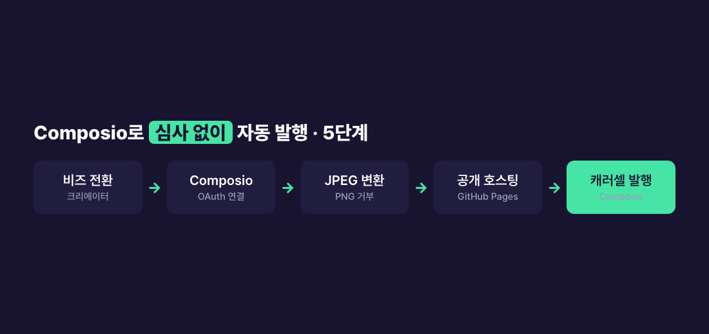

> **🗺 시리즈: 블로그 → 인스타 자동화** — 지금은 **③ 발행**
>
> ← 이전 편: [(2) 벤치마킹 vs 카피, 반응 0에서 바꾼 표지](/posts/blog-to-instagram-automation-3-design/)
>
> ① 설계와 카드 생성 · ② 디자인 · **③** 발행 *(현재 글)* · ④ DM의 벽
{: .prompt-info }

## 문제 — 올리는 것까지 자동이어야 자동화다

카드는 자동으로 나오게 됐다. 그런데 마지막에 사람이 휴대폰으로 사진 6장을 골라 순서대로 올리고 캡션을 붙여 넣는다면, 자동화는 반쪽이다.

자동으로 올리려면 Instagram Graph API가 필요하다. 그런데 직접 앱을 만들어 권한 심사(App Review)를 받는 건 시간과 서류 부담이 크다. 발행 하나 하려고 며칠에서 몇 주를 기다릴 수는 없었다.



## 원인 — 직접 발행에 필요한 것들

Graph API로 게시하려면 세 가지가 필요하다.

- **프로페셔널 계정** — 개인 계정은 API로 게시할 수 없다
- **게시 권한이 있는 앱과 토큰**
- 공개 서비스로 쓰려면 **앱 심사와 비즈니스 인증**

개인이 처음부터 다 갖추기엔 진입장벽이 높다.

## 해결 1 — 승인된 중개자(Composio)로 우회

이미 Meta 승인을 받은 중개 서비스 **Composio**를 쓰면, 내 계정만 OAuth로 연결해 **심사 없이** 캐러셀을 발행할 수 있다. Claude Code에 MCP 서버로 붙여서 대화 중에 발행까지 하게 했다. 단계별로 함정이 있었다.

### 1) 인스타를 비즈니스·크리에이터 계정으로 전환

개인 계정으로는 API 발행이 안 된다. 앱 설정에서 프로페셔널 계정으로 바꾸는 건 무료다.

### 2) Composio 연결 — 토큰을 다시 만들지 말 것

브라우저로 한 번 인증하면 연결된다. 그런데 연결이 자꾸 끊겼다. 원인은 내 쪽에 있었다. 문제가 생길 때마다 **대시보드에서 토큰을 새로 발급**했는데, 새로 발급할 때마다 이전 세션이 무효화되고 있었다(`OAuthException` code 190). 연결이 됐으면 토큰은 건드리지 않는 게 맞다. *(→ [트러블슈팅: OAuth 190 외 3건](/posts/instagram-bot-meta-platform-four-blockers/))*

연결 스크립트에서도 사고가 하나 있었다. 명령 옵션 이름을 틀리게 쓰자(`--header`를 `--headers`로) 에러 메시지에 **API 키가 그대로 찍혀** 나왔다. 키를 즉시 재발급했고, 이후 스크립트는 실패해도 키를 출력하지 않게 고쳤다. 에러 메시지도 로그에 남는 출력이라는 걸 잊으면 안 된다.

### 3) 핸들 한 글자 착오

처음엔 계정 핸들을 밑줄(`_`)이 들어간 이름으로 알고 카드 푸터에 찍었다. OAuth로 연결하고 나서야 실제 핸들은 점(`.`)이라는 걸 알았다. 카드를 전부 다시 렌더했다. 이 일 이후 핸들은 설정 파일 한 곳에만 두고, 템플릿은 그 값을 읽게 바꿨다. 템플릿 안에 남아 있던 기본값까지 찾아서 지웠다. 기본값에 옛 핸들이 남아 있으면 설정이 비었을 때 **조용히 옛 핸들이 찍힌다.**

### 4) PNG는 거부된다 — JPEG + 공개 URL

인스타 API는 **JPEG**만 받고, 파일을 업로드하는 게 아니라 **공개 HTTPS URL**을 주면 Meta 서버가 가져간다. 그래서 두 단계가 더 필요했다.

```bash
# PNG → JPEG (macOS 기본 도구)
sips -s format jpeg -s formatOptions 92 slide.png --out slide.jpg
```

공개 URL은 이미 쓰던 GitHub Pages 블로그 저장소에 카드 폴더를 올려서 확보했다. 추가 비용은 0이다.

### 5) 캐러셀 컨테이너 생성 → 발행

이미지 URL들로 자식 컨테이너를 만들고, 그걸 묶은 캐러셀 컨테이너를 만든 뒤 발행한다. 블로그 글 하나가 카드 6장 캐러셀로 **심사 없이** 올라갔다.

## 올린 뒤에 알게 된 제약 — 고칠 수 없다

첫 게시물을 올리고 CTA 문구를 바꾸고 싶어졌다. 그런데 **API로는 캡션을 고칠 수도, 게시물을 지울 수도 없다.** Composio에도 미디어 삭제 도구가 없었다. 결국 수정본을 새로 올리고, 옛 게시물은 앱에서 손으로 지웠다.

자동 발행은 "되돌리기가 수동"이라는 뜻이다. 그래서 스킬에 **검수 게이트**를 넣었다. 카드 PNG와 캡션 전문을 먼저 보여 주고, 승인받기 전에는 발행하지 않는다.

## 해결 2 — 컴퓨터를 꺼도 도는 예약 발행

시리즈 다섯 편을 하루에 다 올리면 피드 도배가 된다. 이틀 간격으로 나눠 올리기로 했다. 처음엔 내 맥에서 도는 예약 작업으로 걸었는데, 그건 **맥과 앱이 켜져 있어야** 돈다. 컴퓨터를 꺼 둬도 돌게 하고 싶어서 **GitHub Actions의 `schedule`**로 옮겼다.

```yaml
on:
  schedule:
    - cron: "0 10 21,23,25,27 6 *"   # 19:00 KST, 이틀 간격 4회
  workflow_dispatch:                   # 수동 실행·드라이런용
```

이때 발행 방식도 바꿨다. CI 서버에서는 대화형 OAuth가 필요한 Composio 대신, **장기 토큰으로 `graph.instagram.com`을 직접 호출**하는 스크립트를 썼다. 토큰은 저장소 시크릿에 넣었다. 스크립트는 발행 전에 카드 이미지 URL 6개가 전부 열리는지(HTTP 200) 먼저 확인하고, 하나라도 없으면 멈춘다. 발행 직후에는 컨테이너가 아직 준비되지 않았다는 에러가 올 수 있어서 5초 간격으로 재시도한다. 실제 발행 전에는 드라이런으로 CI에서 컨테이너 생성까지 되는 걸 확인했다.

네 번 모두 발행은 성공했다. 그런데 실행 기록을 보니 **예약 시각(10:00 UTC)보다 1시간 22분~2시간 28분 늦게** 시작됐다.

| 예약 | 실제 시작 (UTC) | 지연 |
|---|---|---|
| 6/21 10:00 | 12:06 | 2시간 6분 |
| 6/23 10:00 | 12:28 | 2시간 28분 |
| 6/25 10:00 | 12:12 | 2시간 12분 |
| 6/27 10:00 | 11:22 | 1시간 22분 |

GitHub Actions의 `schedule`은 약속이 아니라 최선을 다하는 정도라서, 늦거나 아예 건너뛸 수 있다. SNS 예약 발행처럼 몇 시간 밀려도 되는 일에는 괜찮지만 정시성이 중요한 일에는 쓰면 안 된다. 석 달 치를 실측해 보니 예약한 실행의 35%만 돌았다. → [GitHub Actions cron이 예약대로 안 도는 이유](/posts/github-actions-cron-skip-resident-runner/)

장기 토큰은 약 **60일**이면 만료된다. 예약 발행을 오래 돌릴 거라면 토큰 갱신도 같이 자동화해야 한다. 이번에는 마지막 발행일까지 유효한 걸 확인하고 걸었다.

## 그 뒤에 밟은 함정 두 가지

### 긴 캡션은 중개자가 깨뜨린다

나중에 줄바꿈과 따옴표가 많은 긴 캡션을 올리다가 Composio 호출이 실패했다. 중개자가 캡션을 JSON에 넣는 과정에서 이스케이프가 깨진 것이다. 이때도 직접 API로 우회했다. 캡션을 파일에 저장하고 URL 인코딩해서 보내면 특수문자를 신경 쓸 필요가 없다.

```bash
curl -X POST "https://graph.instagram.com/v21.0/me/media" \
  --data-urlencode "caption@caption.txt" \
  -d "media_type=CAROUSEL" -d "children=$CHILD_IDS" \
  -d "access_token=$IG_ACCESS_TOKEN"
```

### 영상 카드는 처리가 끝날 때까지 기다려야 한다

[2편](/posts/blog-to-instagram-automation-3-design/)의 애니메이션 카드(mp4)를 캐러셀에 넣으려 하자 Composio의 캐러셀 도구가 영상을 이미지로 취급해 `image_url required` 에러를 냈다. 이것도 직접 API로 갔다. 영상은 이미지와 순서가 다르다.

1. 자식 컨테이너를 `media_type=VIDEO`, `is_carousel_item=true`로 만든다
2. 컨테이너의 `status_code`가 `FINISHED`가 될 때까지 **기다린다**(Meta가 영상을 처리하는 시간)
3. 그다음 캐러셀 부모를 만들고 발행한다

그리고 캐러셀 영상은 **3초 이상**이어야 한다. 2초짜리 애니메이션은 거부됐다. 마지막 프레임을 늘려(ffmpeg `tpad`) 3초를 넘겼다.

## 사용한 기술

- **Composio MCP** — Meta 승인 중개자, 대화 중 발행
- **Instagram Graph API**(`graph.instagram.com`) — 캐러셀 컨테이너 생성·발행, 영상 상태 폴링
- **GitHub Actions `schedule`** — 컴퓨터를 꺼도 도는 예약 발행
- **sips**(PNG→JPEG) · **GitHub Pages**(공개 URL 호스팅) · **ffmpeg**(영상 길이 보정)

> **🧭 기획자·사업자라면**
> - **심사와 인증은 빌릴 수 있다.** 승인된 중개자를 쓰면 출시 시간이 크게 줄어든다. 대신 중개자의 버그와 요금제·정책 변경에 묶인다. 이번에도 두 번은 중개자를 우회해야 했다. 핵심 동선에는 직접 호출하는 대안을 하나 남겨 둬라.
> - **플랫폼 제약은 기획 단계에서 확인하라.** "JPEG만, 공개 URL만, 수정·삭제는 수동, 영상은 3초 이상" 같은 제약은 개발 끝에 알면 일정과 운영 절차가 꼬인다.
> - **"무인 예약"에는 지연이 따른다.** 무료 예약 실행은 몇 시간 밀릴 수 있다. 정해진 시각이 중요한 콘텐츠(이벤트 오픈, 한정 공지)는 유료 예약 도구나 상시 서버가 필요하다.
{: .prompt-tip }

## 정리

- 직접 심사 대신 **승인된 중개자**로 우회하면 개인도 자동 발행이 가능하다. 토큰을 반복 재발급하지 말 것.
- 인스타 발행은 **JPEG + 공개 HTTPS URL**이 전제이고, 캡션 수정과 삭제는 API로 안 된다. 발행 전 미리보기가 필수다.
- 무인 예약은 GitHub Actions로 되지만 1~2시간 지연을 감안해야 하고, 토큰은 약 60일이면 만료된다.

### 시리즈 목차

1. [전체 설계와 카드뉴스 자동 생성](/posts/blog-to-instagram-automation-2-card-generation/)
2. [벤치마킹 vs 카피, 그리고 반응 0에서 바꾼 표지](/posts/blog-to-instagram-automation-3-design/)
3. **Instagram API 심사 없이 자동 발행** (현재 글)
4. [사업자 없으면 DM 자동화 못 한다](/posts/blog-to-instagram-automation-5-dm-wall/)

> 이 단계에서 막혔다면 → [Instagram API OAuthException 190 (트러블슈팅 4건 모음)](/posts/instagram-bot-meta-platform-four-blockers/)
{: .prompt-warning }
