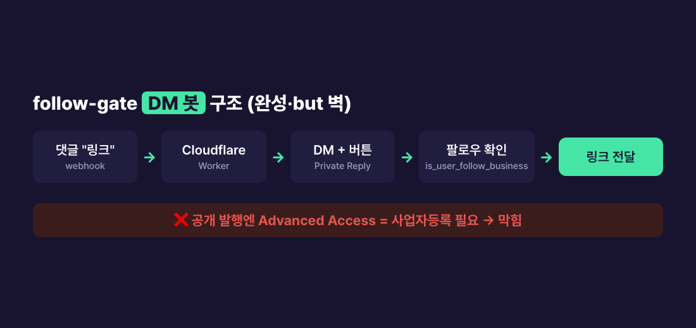

> **🗺 시리즈: 블로그 → 인스타 자동화** — 지금은 **④ DM의 벽** (마지막 편)
>
> ← 이전 편: [(3) Instagram API 심사 없이 자동 발행](/posts/blog-to-instagram-automation-4-publish/)
>
> ① 설계와 카드 생성 · ② 디자인 · ③ 발행 · **④** DM의 벽 *(현재 글)*
{: .prompt-info }

## 문제 — 댓글 단 사람에게 자동으로 링크를 보내고 싶었다

카드 발행까지 자동이 됐으니 마지막 욕심은 DM 자동화였다. 인스타 카드뉴스 계정들이 많이 쓰는 방식이다.

1. 게시물 댓글에 키워드("링크")를 단다
2. 그 사람에게 **자동으로 DM**이 간다
3. 팔로우했는지 확인하고, 했으면 블로그 글 링크를 준다

이런 봇을 **follow-gate**라고 부른다. 유료 도구로도 되지만, 내 블로그 자동화는 전부 무료로 만들어 왔으니 이것도 직접 만들기로 했다.

## 봇은 끝까지 만들었다

서버는 **Cloudflare Workers**(서버리스, 무료 티어)로 했다. 댓글은 Meta가 웹훅으로 알려 주므로 상시 켜져 있는 주소가 필요하다. 그렇다고 서버를 따로 빌리면 돈이 든다. 워커는 요청이 올 때만 깨어나니 이 용도에 맞았다.

봇의 흐름은 이렇다.

1. **댓글 웹훅 수신** → 키워드 "링크"가 있는지 확인
2. **Private Reply**로 댓글 단 사람에게 DM 발송. 메시지에 "팔로우했어요" 버튼(quick reply)을 붙인다
3. 버튼을 누르면 **`is_user_follow_business`** 필드로 팔로우 여부를 조회
4. 팔로우했으면 블로그 링크를, 아니면 팔로우 안내를 다시 보낸다
5. 같은 사람에게 두 번 보내지 않도록 **KV 저장소**에 처리 기록을 남긴다

팔로우 확인이 되느냐가 가장 큰 의문이었는데, 가능했다. 단 조건이 있다. 상대가 내 DM에 답하거나 버튼을 눌러 **먼저 상호작용해야** 그 사람의 프로필 정보를 조회할 수 있다. 버튼을 둔 이유가 이것이다.

배포 후 확인한 것은 이렇다.

| 확인 항목 | 결과 |
|---|---|
| 워커 로직 (가짜 댓글 요청을 직접 보내 봄) | ✅ 댓글 → DM 발송 시도까지 동작 |
| Meta → 워커 전달 (앱 대시보드의 Test 웹훅) | ✅ 워커에 도착 |
| 웹훅 주소 검증 (Meta가 보내는 확인 요청) | ✅ 통과 |
| **실제 계정이 단 진짜 댓글** | ❌ **웹훅이 오지 않음** |

마지막 줄이 문제였다.

## 원인 — 개발 모드의 벽, 그 뒤의 사업자 벽

### 개발 모드에서는 테스터의 이벤트만 온다

Meta 앱은 처음에 **개발 모드**다. 개발 모드에서는 앱에 **테스터로 등록된 계정의 이벤트만** 웹훅으로 온다. 일반 팔로워의 댓글은 아예 전달되지 않는다.

그래서 댓글 테스트용 계정을 테스터로 초대했는데, 이번엔 초대 수락이 제대로 되지 않았다. 수락 화면이 동작하지 않아 한참 애먹었다. 수락된 것처럼 보인 뒤에도 그 계정의 댓글은 워커에 오지 않았고, 댓글 조회 API도 0건을 돌려줬다. 테스터 역할이 제대로 인식되지 않은 것이다. 이 과정의 에러와 우회법은 [트러블슈팅 4건 모음](/posts/instagram-bot-meta-platform-four-blockers/)에 따로 정리했다.

### 공개로 가려면 Advanced Access, 그러려면 사업자

테스터 문제를 풀어도 남는 벽이 있다. 공개 팔로워의 댓글과 DM은 **남의 데이터**다. 이걸 처리하려면 댓글·메시지 권한을 **Advanced Access**로 받아야 하고, 그러려면 **앱 심사(App Review) + 비즈니스 인증**이 필요하다.

비즈니스 인증은 **등록된 사업체(법인·개인사업자)**를 전제로 한다. 인정되는 서류가 전부 사업체 명의라서 개인 신분증이나 개인 명의 공과금 고지서로는 인증이 안 된다.

혹시 다른 길이 있나 싶어 Meta 상담 채널에 직접 물었다. 답은 같았다. **사업자등록 후 앱 심사를 받거나, 공식 파트너(ManyChat 등)를 쓰라**는 것이었다.

### 심사 준비물은 미리 만들어 뒀다

심사 신청 직전까지는 가 봤다. 앱 심사에 필요한 것들이다.

- **개인정보처리방침 URL** — 블로그에 페이지를 만들어 앱에 등록했다
- **권한별 사용 목적 설명** — 왜 댓글 읽기와 메시지 보내기 권한이 필요한지
- **심사자가 따라 할 절차와 시연 영상** — 댓글 → DM → 버튼 → 링크까지 실제로 도는 화면

시연 영상을 찍으려면 실제 댓글이 한 번은 봇을 거쳐야 하는데, 앞의 테스터 문제로 그 한 번을 못 만들었다. 그리고 그다음 단계가 비즈니스 인증이었다.

## 결론 — 세 갈래 길과 각각의 비용

코드와 인프라는 완성돼 있다. 막힌 건 기술이 아니라 **자격**이다. 그래서 선택지를 비용으로 비교했다.

| 길 | 드는 것 | 얻는 것 |
|---|---|---|
| **(a) 개인사업자 등록 → 앱 심사** | 등록 자체는 무료(홈택스). 심사는 수일~수주. 사업자로서의 신고 의무가 생긴다 | 만들어 둔 봇이 그대로 부활. follow-gate 포함 운영비 0 |
| **(b) ManyChat 같은 공식 파트너** | 내 인증 불필요. 단 무료 플랜은 월 25명 한도에 팔로우 확인 기능 없음(2026년 6월 확인 당시) | 바로 쓸 수 있음. 팔로우 확인까지 원하면 유료 |
| **(c) DM은 보류, 카드 발행만** | 댓글로 오는 잠재 독자를 직접 응대 | 비용·리스크 없음 |

나는 **(c)**를 골랐다. 지금 계정 규모에서는 댓글에 직접 답하는 게 가장 싸다. 카드 마지막 장의 행동 유도 문구도 "댓글에 '링크'를 남기면 보내 드려요"에서 **"팔로우하고 프로필 링크(블로그)에서 자세히"**로 바꿨다. 사업자등록을 하게 되면 (a)로 넘어간다. 봇 코드는 그대로 남아 있다.

하나 더 기억할 것이 있다. 봇이 쓰는 인스타 토큰도 약 60일이면 만료된다. (a)로 부활시키면 토큰 갱신을 함께 자동화해야 한다.

## 사용한 기술

- **Cloudflare Workers + KV** — 서버리스 웹훅 봇, 중복 발송 방지(무료 티어)
- **Instagram Messaging API** — Private Reply, quick reply 버튼, `is_user_follow_business`(팔로우 확인)
- **Meta 앱 웹훅** — 댓글·메시지 이벤트 구독
- **Meta App Review / 비즈니스 인증** — 바로 이 단계가 벽

> **🧭 기획자·사업자라면**
> - **"개인 vs 사업자"는 기술이 아니라 자격의 문제다.** 남의 데이터(댓글·DM)를 다루는 자동화는 본질적으로 사업자 인증을 요구한다. 사업화할 생각이 있다면 등록이 오히려 여러 문을 한꺼번에 연다.
> - **만들기 전에 자격 요건부터 확인하라.** 이번엔 봇을 다 만든 뒤에 벽을 만났다. "이 기능에 어떤 권한이 필요하고, 그 권한은 누구에게 주어지나"를 먼저 물었다면 구축 시간을 아낄 수 있었다.
> - **직접 구축 vs 공식 파트너는 규모로 판단하라.** 응대할 사람이 월 수십 명이면 무료 파트너나 직접 응대로 충분하다. 수백 명을 넘으면 그때 사업자등록과 자체 봇의 운영비 0이 의미를 갖는다.
{: .prompt-tip }

## 정리

- **사업자등록이 없으면 자체 앱으로는 공개 팔로워 대상 DM 자동화가 불가능하다**(Meta 정책, 상담으로 확인).
- 개발 모드에서는 테스터 계정의 이벤트만 웹훅으로 온다. Test 버튼이 된다고 실제 댓글이 오는 게 아니다.
- 봇 코드는 완성돼 있어 등록만 하면 부활한다. 그 전까지의 무료 대안은 공식 파트너나 직접 응대다.

### 시리즈 목차

1. [전체 설계와 카드뉴스 자동 생성](/posts/blog-to-instagram-automation-2-card-generation/)
2. [벤치마킹 vs 카피, 그리고 반응 0에서 바꾼 표지](/posts/blog-to-instagram-automation-3-design/)
3. [Instagram API 심사 없이 자동 발행](/posts/blog-to-instagram-automation-4-publish/)
4. **사업자 없으면 DM 자동화 못 한다** (현재 글)

> 봇을 만들다 막혔다면 — 트러블슈팅 4건을 한 편에 모았습니다:
> [인스타 자동화 봇이 막히는 네 지점](/posts/instagram-bot-meta-platform-four-blockers/) (OAuth 190 세션 무효 · 테스터 초대 Pending · 댓글 webhook 안 옴 · wrangler login 실패)
{: .prompt-warning }
