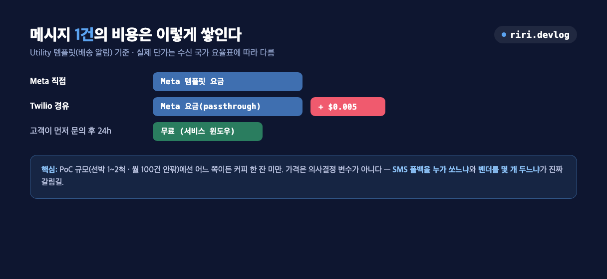

## 문제

글로벌 고객에게 주문·배송 상태를 왓츠앱으로 알리는 기능을 설계하다 벽에
부딪혔다. "왓츠앱 비즈니스 API는 Meta에 직접 앱 등록하면 무료 아닌가?"라고
막연히 생각했는데, 파고들수록 무료가 아니었고 선택지도 하나가 아니었다.

정리해야 할 질문이 이만큼이었다.

- Meta Cloud API 직접 연동은 정말 무료인가?
- Twilio 같은 BSP(Business Solution Provider)를 끼면 뭐가 더 붙나?
- 어느 쪽이든 왓츠앱을 쓰려면 뭘 먼저 준비해야 하나?
- 발송 실패 시 SMS 폴백은 누가 처리하나?

## 원인 (무료의 실체)

"Meta 직접이면 무료"는 반은 맞고 반은 틀리다.

- **인프라(Cloud API 접근·호스팅)는 무료** — 맞다. Meta가 직접 호스팅하고
  접근 비용이 없다.
- 하지만 **메시지 자체는 유료** — 2025년 7월 1일부터 대화(conversation)
  단위가 아니라 **건당 과금**으로 바뀌었다. 요율은 템플릿 카테고리와 수신자
  국가번호에 따라 다르다.

우리가 보낼 배송 알림은 **Utility(유틸리티) 카테고리**로, 마케팅보다 싼
등급이다. 글을 쓸 당시에는 고객이 먼저 메시지를 보낸 뒤 24시간(고객 서비스
기간) 안에 보내는 Utility 메시지가 무료였다.

> **2026년 10월 1일부터 바뀌었다.** 고객 서비스 기간 안에 보내는 Utility
> 메시지도 이제 요금이 붙는다. 템플릿이 아닌 일반 답장(서비스 메시지)도
> 유료로 돌아섰고, 대신 비즈니스 전화번호마다 **매월 1,000건**은 무료다
> (이월 없음). 결제 수단이 없으면 무료분을 넘긴 서비스 메시지는 전송되지
> 않는다. (Meta 개발자 문서 「WhatsApp Business 플랫폼의 가격」, 2026-09-30
> 업데이트판을 2026-11-17에 확인)
{: .prompt-warning }

여기에 더해, 어느 쪽을 고르든 **공통으로 필요한 것**이 있다.

- **Meta 비즈니스 인증** (사업자등록 기반)
- **WABA**(WhatsApp Business Account)와 발신 번호 등록
- **템플릿 사전 승인** — 기업이 먼저 보내는 모든 메시지는 승인된 템플릿이어야
  한다. 상태가 10단계면 템플릿도 그만큼 승인받아야 한다(심사 대기열이 생긴다).

## 해결 과정 (의사결정)

### 1. 비용 구조를 실제로 비교

메시지 1건의 비용을 뜯어보면 이렇게 쌓인다.

- **Meta 직접**: Meta 템플릿 요금만.
- **Twilio 경유**: 같은 Meta 요금이 그대로 전가(passthrough)되고, 그 위에
  Twilio 수수료 **건당 $0.005**(수신·발신 모두)가 붙는다. 여기에 최종 상태가
  `Failed`로 끝난 메시지에는 건당 $0.001의 실패 처리 수수료가 따로 붙는다
  (Twilio WhatsApp 요금 페이지, "2026년 9월 기준" 표기, 2026-11-17 확인).

### 2. 진짜 변수는 가격이 아니었다

여기서 함정 — 규모를 넣어보면 가격은 의사결정 변수가 아니다. 소규모 알림
(예: 월 100건 안팎)이면 Twilio 수수료를 다 더해도 커피 한 잔이 안 된다.
진짜 갈림길은 두 가지였다.

- **SMS 폴백을 누가 쏘나** — 왓츠앱이 실패했을 때 SMS로 대체 발송하는 경로.
- **벤더를 몇 개 두나** — Meta 직접이면 왓츠앱과 SMS가 별도 벤더라 2개,
  Twilio면 왓츠앱+SMS를 **한 API**로 처리한다.

### 3. 선택: Twilio 단일 스택

Twilio는 왓츠앱과 SMS를 한 API로 제공하고, **SMS 폴백이 내장**돼 있으며,
WhatsApp Self Sign-up으로 승인 대기를 우회해 카드 등록만으로 바로 시작할 수
있다. 국내 문자 사업자(예: NHN Cloud) 승인을 기다리던 상황에서, Twilio 하나로
발송·폴백·번호 관리를 묶으면 일정 리스크가 줄었다.

> 단, Twilio를 써도 **Meta 비즈니스 인증·WABA·템플릿 승인은 똑같이 필요**하다.
> Twilio가 그 과정을 콘솔에서 대행할 뿐, 건너뛰는 게 아니다.

Twilio 문서에서 폴백은 **Channel Fallback**이라는 이름으로 설명돼 있다. 발신
번호들을 묶은 Sender Pool에서 보내면서, 수신자의 왓츠앱 주소와 일반 전화번호를
함께 넘기면 된다. 기본 채널 전달이 실패하면 Twilio가 다음 채널로 자동으로 다시
보낸다. `priority`로 시도 순서를 정하고, `filterIn`으로 특정 채널을 뺄 수 있다.
문서에 "왓츠앱 실패 후 SMS로 폴백하려면 두 주소를 모두 지정하라"는 예가 그대로
나온다.

## 도입 전에 확인할 운영 규칙 네 가지

벤더를 골랐다고 끝이 아니다. 실제로 첫 메시지를 보내기 전에 걸리는 규칙이 더
있다. 아래는 모두 2026-11-17에 Meta 개발자 문서에서 다시 확인한 내용이다.
왓츠앱 정책은 분기마다 바뀌므로, 도입 시점에 한 번 더 확인하길 권한다.

### 1. 템플릿 카테고리는 내가 정하는 게 아니다

기업이 먼저 보내는 메시지(템플릿)는 세 카테고리 중 하나로 분류되고, 요금도
카테고리별로 다르다.

| 카테고리 | 용도 | 예 |
|---|---|---|
| **마케팅** | 인지도·매출·재방문 유도 | 할인 안내, 장바구니 알림 |
| **유틸리티** | 사용자의 행동·요청에 대한 후속 안내 | 주문 확인, 배송 상태 |
| **인증** | 사용자 신원 확인 | 일회용 인증번호 |

주의할 점은 **카테고리를 Meta가 다시 매긴다**는 것이다. 2025년 4월 9일부터는
유틸리티로 제출한 템플릿을 Meta가 마케팅이라고 판단하면 **마케팅으로 승인**한다.
이의 제기는 카테고리가 바뀐 날로부터 60일 안에 할 수 있다. 배송 알림에 "다음
구매 시 10% 할인" 한 줄을 붙이는 순간 마케팅 요금이 될 수 있다는 뜻이다. 알림과
홍보는 템플릿을 나누는 게 안전하다.

### 2. 옵트인(수신 동의) 없이는 보낼 수 없다

번호만 안다고 보낼 수 있는 게 아니다. Meta 정책상 기업은 메시지를 보내기 전에
옵트인을 받아야 한다. 요건은 세 가지다.

- 사용자가 **이 기업의 연락을 받겠다는 데 동의한다**는 사실이 드러날 것
- 동의 대상인 **기업 이름**을 밝힐 것
- 해당 국가의 법률을 지킬 것

동의는 왓츠앱 전용일 필요는 없고, 웹사이트·SMS·전화 자동응답·서면 등 어떤
경로로 받아도 된다. 실무에서는 회원가입이나 주문서에 "왓츠앱으로 주문·배송
알림 받기" 체크박스를 두는 식이다. 국가별 법률은 따로 확인해야 한다.

### 3. 처음에는 하루 250명까지만 보낼 수 있다

발신 한도는 **24시간 동안 고객 서비스 기간 밖에서 메시지를 보낼 수 있는 고유
사용자 수**다. 새로 만든 비즈니스 포트폴리오는 **250명**에서 시작한다.

| 단계 | 올라가는 방법 |
|---|---|
| 250 | 시작값 |
| 2,000 | 비즈니스 인증 완료, 또는 30일 안에 고품질 템플릿으로 고유 사용자 2,000명에게 발송 |
| 10,000 → 100,000 → 무제한 | 자동 상향. 품질이 높고, 최근 7일간 현재 한도의 절반 이상을 쓰면 6시간 안에 한 단계 오른다 |

두 가지가 바뀐 지 얼마 안 됐다. 한도가 **전화번호별이 아니라 비즈니스 포트폴리오
전체 기준**이 됐고(번호가 여러 개면 한도를 나눠 쓴다), 첫 상향 단계가 1,000에서
2,000으로 올랐다(2025년 10월 변경). 예전 블로그 글에 "1K 티어"가 나오면 지난
정보다.

### 4. 템플릿은 이런 이유로 거절된다



템플릿 심사는 최대 24시간 걸린다. Meta 문서가 꼽는 흔한 거절 사유는 대부분
**변수 형식** 문제다.

- 변수 중괄호가 짝이 안 맞는다. 올바른 형식은 `{{1}}`
- 변수에 `#`, `$`, `%` 같은 특수문자가 들어 있다
- 변수 번호가 순서대로가 아니다(`{{1}}`, `{{2}}`, `{{5}}`)
- 문장 길이에 비해 변수가 너무 많다
- **문장이 변수로 시작하거나 변수로 끝난다**
- 카드번호·계좌번호 전체 같은 민감한 정보를 요청한다
- 법적 조치로 위협하는 등 모욕적·위협적인 내용
- 기존 템플릿과 중복된다

변수가 있는 템플릿은 제출할 때 **샘플 값**도 함께 넣어야 한다. 배송 알림이라면
`{{1}}님의 주문이 발송되었습니다`처럼 변수로 시작하는 문장이 흔한데, 이건
거절 사유다. `안녕하세요, {{1}}님. 주문하신 상품이 발송되었습니다.`처럼 앞뒤에
고정 문구를 둔다.


## 사용한 기술

- **WhatsApp Business Platform (Cloud API)** — Meta 직접 연동. 인프라 무료,
  메시지 건당 과금(2025-07 개편), 템플릿 사전 승인 필수
- **Twilio** — BSP(Business Solution Provider). 왓츠앱+SMS 단일 API, SMS 폴백
  내장, Self Sign-up, 건당 $0.005 수수료
- **Utility 템플릿 / 24시간 고객 서비스 기간** — 배송 알림의 과금 등급. 기간 안 Utility 무료는 2026-10-01에 종료
- **Twilio Channel Fallback** — 기본 채널 실패 시 다음 채널(SMS)로 자동 재발송
- **발신 한도 / 옵트인 / 템플릿 심사** — 첫 발송 전에 걸리는 Meta 운영 규칙

> **🧭 기획자·사업자라면**
> 1. "무료 API"라는 말은 대개 **인프라가 무료**라는 뜻이지 메시지가 무료라는 뜻이 아니다. 채널 비용은 건당 요율 × 발송량으로 잡아야 하고, PoC 규모에선 대체로 무시 가능하지만 대량 발송으로 가면 카테고리(Utility vs 마케팅)가 비용을 가른다.
> 2. 벤더를 하나로 묶을지(Twilio) 직접 여러 개를 붙일지(Meta+문자사)는 비용이 아니라 **운영 복잡도와 일정 리스크**의 문제다. 승인 대기가 크리티컬 패스라면, 수수료를 조금 더 내더라도 대기를 우회하는 쪽이 프로젝트를 살린다.
{: .prompt-tip }

## 정리

1. Meta Cloud API는 인프라만 무료다. 메시지는 2025년 7월부터 건당 과금이며, 배송 알림은 마케팅보다 싼 Utility 등급이다. 2026년 10월부터는 고객 서비스 기간 안의 Utility도 유료다.
2. Twilio를 끼우면 Meta 요금 passthrough + 건당 $0.005가 붙지만, 소규모에선 비용 차이가 무의미하다.
3. 진짜 결정 변수는 가격이 아니라 SMS 폴백 처리와 벤더 수 — 승인 대기를 우회하려면 왓츠앱+SMS를 한 API로 묶는 Twilio가 유리했다. 단 Meta 비즈니스 인증·템플릿 승인은 어느 쪽이든 필요하다.
4. 벤더와 별개로 옵트인, 하루 250명에서 시작하는 발신 한도, 카테고리 재분류, 템플릿 변수 규칙은 첫 발송 전에 설계에 넣어야 한다.
