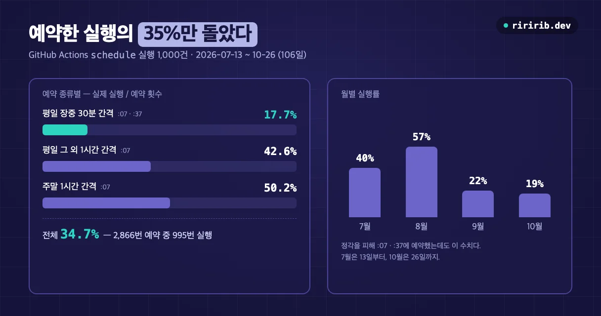
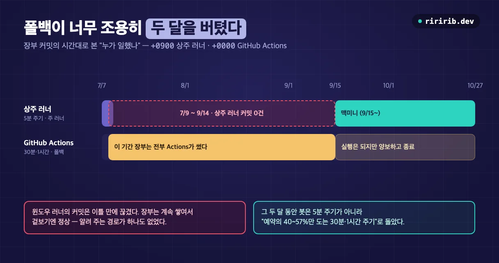

## 문제

자동매매 봇(모의투자)을 GitHub Actions `schedule`로 돌렸다. 평일 장중에는 30분마다, 그 밖의 시간에는 1시간마다 한 번씩 매매 사이클을 돌리는 설정이다.

```yaml
on:
  schedule:
    - cron: "7,37 0-6 * * 1-5"   # KRX 장중 30분마다 (09:07~15:37 KST)
    - cron: "7 7-23 * * *"       # 그 외 매시 7분 (코인 전용 시간대)
```

첫날 실행 이력을 보니 **그날 예정된 11번 중 실제로 돈 건 1번**이었다. 그마저 예정보다 27분 늦었다.

```
gh run list --workflow "Intraday Trading"
2026-07-07T04:34:37Z schedule completed   ← 오늘 유일
(나머지 스케줄 트리거는 실행 기록 자체가 없음)
```

실패 기록이 남은 게 아니다. **실행 기록 자체가 없다.** 워크플로가 에러를 낸 게 아니라 GitHub이 시작을 안 한 것이다. 단타 봇에서 이러면 매매 기회를 놓치고, 들고 있는 포지션의 손절 감시도 그만큼 늦어진다.

## 원인 — schedule은 약속이 아니다

GitHub 공식 문서에 답이 있다(2026-10 확인). `schedule` 이벤트는 GitHub Actions 부하가 높을 때 늦어질 수 있고, 매시 정각이 대표적인 고부하 시간이며, 부하가 충분히 높으면 대기 중인 작업 일부가 **버려질 수 있다**고 적혀 있다.

> "If the load is sufficiently high enough, some queued jobs may be dropped."
> — [GitHub Docs, Events that trigger workflows](https://docs.github.com/en/actions/reference/workflows-and-actions/events-that-trigger-workflows#schedule)

문서가 권하는 대책은 정각을 피해 다른 분에 예약하는 것이다. 이 봇은 처음부터 정각을 피해 **매시 7분·37분**에 예약했다. 그런데도 11번 중 1번이었다.

같은 문서에서 함께 알아 둘 것:

- 가장 짧은 예약 간격은 **5분**이다.
- 예약 실행은 **기본 브랜치**에서만 돈다. 다른 브랜치에 워크플로 파일을 고쳐 넣으면 반영되지 않는다.
- 기본 시간대는 **UTC**다. 지금은 `timezone: "Asia/Seoul"`처럼 IANA 시간대를 지정할 수 있다.
- **공개 저장소**는 60일 동안 저장소 활동이 없으면 예약 실행이 자동으로 꺼진다.

## 석 달 실측 — 예약한 실행의 35%만 돌았다

첫날 하루치로는 "운이 나빴다"와 구분이 안 된다. 이 워크플로는 석 달 넘게 계속 돌고 있어서, 쌓인 실행 기록 1,000건으로 실제 실행률을 셌다.

```bash
gh run list --workflow "Intraday Trading" --event schedule \
  --limit 1000 --json createdAt,conclusion
```

기간은 2026-07-13~10-26(UTC 기준 106일)이다. 날짜마다 cron 설정상 예약 횟수(평일 31번, 주말 17번)와 실제 실행 횟수를 비교했다.



| 예약 종류 | 실제 실행 / 예약 | 실행률 |
|---|---|---|
| 평일 장중 30분 간격 (:07·:37) | 188 / 1,064 | **17.7%** |
| 평일 그 외 1시간 간격 (:07) | 551 / 1,292 | 42.6% |
| 주말 1시간 간격 (:07) | 256 / 510 | 50.2% |
| **전체** | **995 / 2,866** | **34.7%** |

숫자에서 읽히는 것 세 가지:

1. **정각을 피하는 것만으로는 부족하다.** 처음부터 :07·:37에 예약했는데도 전체 실행률이 35%다.
2. **촘촘하게 예약할수록 더 많이 빠진다.** 평일 장중 30분 간격이 17.7%로 가장 낮다. 30분마다 돌리려고 예약을 늘려도 실제로는 2시간 반에 한 번꼴로 돈 셈이다.
3. **달마다 들쭉날쭉하다.** 월별 실행률은 7월 40% → 8월 57% → 9월 22% → 10월 19%였다. 설정은 한 번도 바꾸지 않았다. 지난달 수치로 이번 달을 예상할 수 없다.

실행 사이 가장 긴 공백은 **13.5시간**(10/10)이었다. 그 시간대는 원래 예약 공백이 7시간이니, 6시간 넘게 예약이 통째로 빠졌다.

> 이 수치는 이 저장소 한 곳의 측정이다. GitHub 전체 부하와 시기에 따라 다를 수 있다. 다만 "가끔 늦는다" 수준이 아니라는 건 분명하다.
{: .prompt-warning }

## 해결 — 상주 러너를 주로, Actions는 폴백으로

방향은 "클라우드 하나에 의존하지 않는다"였다. 정시성은 내 컴퓨터에서 상시 도는 러너가 맡고, GitHub Actions는 그 러너가 죽었을 때만 대신 일한다.

**1. 상주 러너.** 처음엔 늘 켜 두는 윈도우 노트북에서 봇을 5분 주기로 돌렸다. 배치 스크립트가 크래시 나면 60초 뒤 다시 띄우고, 봇은 6시간마다 스스로 종료한다. 그러면 스크립트가 `git pull`로 최신 코드를 받아 다시 띄운다. 코드를 고치면 하루 안에 사람 손 없이 반영된다.

```bat
:loop
git pull --rebase --autostash origin main
python -m app.intraday_bot --loop 300 --push
timeout /t 60 /nobreak >nul
goto loop
```

**2. Actions는 폴백.** 두 러너가 동시에 돌면 같은 장부에 두 번 기록해 장부가 갈라진다. 그래서 Actions로 실행될 때는 먼저 "다른 러너가 살아 있나"를 확인하는 **스테일 가드**를 넣었다.

```python
def _other_runner_active(cfg, window_min: int = 25) -> bool:
    """최근 window_min 내 다른 러너의 사이클 흔적이 있으면 True."""
    if os.environ.get("INTRADAY_FORCE") == "1":
        return False
    try:
        st = load_state(cfg.get("capital", 500_000))
        sigs = st.get("signals") or []
        if not sigs:
            return False
        last = datetime.fromisoformat(sigs[-1]["ts"])
        age = (datetime.now(KST) - last).total_seconds()
        return age < window_min * 60
    except Exception:
        return False
```

- 장부의 마지막 사이클이 25분 안이면 → Actions는 **양보하고 종료**한다.
- 25분 넘게 흔적이 없으면 → 상주 러너가 죽은 것으로 보고 Actions가 **넘겨받는다.**

워크플로에는 `concurrency` 그룹도 걸어 Actions 실행끼리 겹치지 않게 했다.

```yaml
concurrency:
  group: intraday-trading
  cancel-in-progress: false
```

**3. 첫날 검증.** 만든 날 밤 윈도우 노트북이 절전으로 꺼졌는데, 아침에 보니 Actions가 밤새 이어받아 장부가 계속 쌓여 있었다. 어느 러너가 기록했는지는 **커밋 시간대**로 구분된다. 상주 러너는 한국 시간(`+0900`), Actions는 UTC(`+0000`)로 찍힌다.

```
15:52 커밋 +0900  → 윈도우 러너
01:35 커밋 +0000  → Actions 폴백 (윈도우 다운 후 인계)
```

여기까지가 처음 글을 쓸 때의 결론이었다. 그런데 석 달을 돌려 보니 이 이중화가 새 함정을 두 개 만들었다.

## 이중화가 만든 함정 ① — 폴백이 너무 조용히 일했다

장부 커밋을 시간대별로 세어 보면 누가 일했는지가 그대로 보인다.

| 기간 | 상주 러너 커밋 (`+0900`) | Actions 커밋 (`+0000`) |
|---|---|---|
| 7월 | 17 (전부 7/7~7/8) | 266 |
| 8월 | **0** | 464 |
| 9월 | 1,026 (9/15부터) | 90 (9/15까지) |
| 10월 | 512 | 0 |



**윈도우 러너의 커밋은 7/8을 끝으로 끊겼다.** 그 뒤 9/15에 맥미니를 상주 러너로 붙이기까지 약 두 달 동안 장부는 전부 Actions가 썼다.

아무도 몰랐던 이유는 폴백이 제 역할을 했기 때문이다. 장부는 계속 쌓이고 에러도 없으니 겉보기에는 정상이다. 그런데 그 두 달 동안 봇은 5분 주기가 아니라 **"예약의 40~57%만 도는 30분·1시간 주기"**로 돌았다. 폴백이 넘겨받았다는 사실을 알려 주는 경로가 하나도 없었다.

대응은 두 가지였다.

- **폴백이 넘겨받으면 텔레그램으로 알린다.** 상주 러너가 죽어 있는 동안 Actions가 실행될 때마다 알리면 같은 장애로 알림이 쏟아지므로, 6시간 쿨다운을 두고 쿨다운 시각을 장부에 남겨 러너끼리 공유한다.
- **상주 러너를 늘 켜져 있는 기계로 옮겼다.** 노트북 대신 맥미니에서 launchd로 띄운다. 맥에서 상주 프로세스를 돌릴 때의 함정은 [맥미니를 24시간 봇 러너로 만들기]()에 따로 정리했다.

## 이중화가 만든 함정 ② — 살아 있는 러너를 죽었다고 판정했다

스테일 가드는 **main 브랜치에 올라온 장부**를 보고 판정한다. 그런데 상주 러너는 커밋이 너무 잦아지지 않도록 매매가 없으면 장부를 30분마다만 push하고 있었다.

두 숫자가 어긋나 있었다.

- 스테일 가드의 판정 창: **25분**
- 상주 러너의 push 주기: **30분**

매매가 없는 조용한 구간에서는 상주 러너가 멀쩡히 돌아도 main의 장부가 25분 넘게 낡아 보인다. 그러면 Actions가 "상주 러너가 죽었다"고 판정하고 끼어들어 같은 장부에 기록한다. 실제로 맥미니의 로컬 장부가 Actions의 청산을 모른 채 같은 포지션을 13분 뒤에 다시 청산하는 분기가 관측됐다(그때는 push를 꺼 둔 상태라 main은 오염되지 않았다).

고친 방법은 단순하다. **push 주기(20분)가 판정 창(25분)보다 항상 짧게** 했다. 두 상수가 서로 묶여 있다는 사실을 양쪽 코드 주석에 남겼다. 한쪽만 바꾸면 같은 문제가 다시 생기기 때문이다.

```python
# 매매 발생 즉시 or 20분마다 푸시(커밋 소음 억제).
# 20분은 _other_runner_active 의 스테일가드 창(25분)보다 짧아야 한다.
if n != prev_trades or time.time() - last_push > 1200:
    _push_state()
```

## 사용한 기술

- **GitHub Actions `schedule`** — best-effort 예약. 부하가 높으면 늦어지거나 버려진다. 최소 간격 5분, 기본 브랜치만, 기본 UTC(`timezone` 지정 가능).
- **`gh run list --event schedule --json`** — 예약 실행 이력을 뽑아 실제 실행률을 세는 데 썼다.
- **상주 러너 + 폴백 이중화** — 로컬 상주 러너가 정시성을, 클라우드 예약 실행이 생존을 맡는다.
- **스테일 가드** — 마지막 활동 시각으로 "다른 러너가 살아 있나"를 판정해 장부에 기록하는 러너를 하나로 유지한다. 판정 근거가 갱신되는 주기보다 창이 길어야 한다.
- **커밋 시간대 지문** — `+0900` / `+0000`으로 어느 기계가 커밋했는지 나중에 추적한다.

> **🧭 기획자·사업자라면**
> - **"예약해 뒀다"는 "실행된다"가 아니다.** 무료 클라우드 예약 실행은 이 측정에서 30분 간격 예약의 18%만 돌았다. 정시성이 필요한 업무(결제 마감, 알림 발송, 시세 감시)라면 예약 기능의 보장 수준부터 확인해야 한다.
> - **이중화는 장애를 숨긴다.** 폴백이 잘 돌수록 주 시스템이 죽은 걸 늦게 안다. 이중화를 설계할 때는 "폴백이 넘겨받았다"는 알림을 같이 설계해야 한다.
> - **서로 묶인 설정값은 문서로 묶는다.** 판정 창 25분과 push 주기 20분처럼 한쪽만 바꾸면 고장 나는 값은, 담당자가 바뀌어도 알 수 있게 코드와 문서 양쪽에 남겨야 한다.
{: .prompt-tip }

## 정리

1. **GitHub Actions cron은 예약이 아니라 희망 사항이다.** 석 달 실측으로 예약한 실행의 34.7%만 돌았고, 정각을 피해도 30분 간격은 17.7%였다.
2. **정시성이 필요하면 상주 러너를 주로, 클라우드를 폴백으로** 둔다.
3. **폴백에는 인계 알림을 달고, 판정 창은 갱신 주기보다 길게** 잡는다. 그렇지 않으면 이중화가 장애를 숨기거나 장부를 갈라 놓는다.

---

> 이 글은 [AI 자동매매 봇 3주 검증 회고]()의 트러블슈팅 글 중 하나입니다. 같은 봇에서 숫자가 틀렸던 사례는 [자동매매 봇의 숫자가 틀렸던 세 번]()에, Claude Code를 launchd로 매일 돌리는 방법은 [Claude Code headless 무인 실행]()에 있습니다.
{: .prompt-info }
