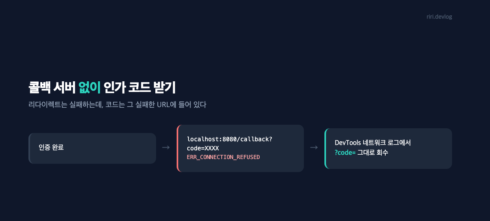

> **시리즈 「네이버 서이추 자동화」**
> [1편 JS click이 안 먹히는 버튼](/posts/naver-buddy-automation-1-js-vs-real-click/) · **2편 (현재 글)** · [3편 웹훅은 없다](/posts/naver-buddy-automation-3-no-webhook-polling/) · [4편 토큰 99% 줄이기](/posts/naver-buddy-automation-4-browser-token-diet/) · [5편 자동화 티는 어디서 나는가](/posts/naver-buddy-automation-5-automation-tell/)
{: .prompt-info }

## 먼저 한눈에 — 카페 글쓰기 API 준비물

이 글은 실제로 막혔다 뚫은 순서대로 적었다. 바로 쓰려는 사람을 위해 필요한 것만 먼저 모았다.

| 준비물 | 어디서 얻나 | 빠지면 |
|---|---|---|
| 애플리케이션 + **카페 API 권한** | 개발자센터 → 내 애플리케이션 → API 설정에 `카페` 추가 | 403 (카페 문서 기준. 공통 에러 문서는 같은 원인을 401로 안내) |
| **로그인 오픈 API 서비스 환경**(Callback URL) | 같은 화면 → 로그인 오픈 API 서비스 환경 → PC 웹 | OAuth 인증 자체를 시작 못 함 ([원인](#원인--로그인-오픈-api-서비스-환경callback-url-미등록)) |
| 동의 항목 **`카페가입, 글쓰기`** | OAuth 동의 화면에서 체크 | 글쓰기 API 사용 불가 ([2단계](#2-oauth-인증)) |
| access_token | 인가 코드 → 토큰 교환 ([2~4단계](#2-oauth-인증)) | 401 |
| **clubid** (카페 고유 숫자) | 카페 관리 페이지 등 주소의 `clubid=숫자` | AP006 (카페 없음) 등 |
| **menuid** (게시판 번호) | 게시판 링크 주소의 `search.menuid=숫자` | AP001 (파라미터 오류) 등 |

전체 흐름은 `앱 설정 → authorize → code → token → POST /v1/cafe/{clubid}/menu/{menuid}/articles` 다섯 단계다. 요청 변수 전체와 에러 코드는 [아래 레퍼런스](#요청-변수-전체--공개-범위-기본값을-조심)에 정리했다.

## 문제

[1편](/posts/naver-buddy-automation-1-js-vs-real-click/)에서 카페 글쓰기를 **스마트에디터에 실제 키보드로 타이핑**해서 해결했다. 동작은 했지만 취약했다. 스냅샷으로 문단 uid를 찾고, 캐럿을 옮기고, 한 글자씩 넣는다. 에디터 DOM이 조금만 바뀌어도 깨진다. 에디터 자동화가 조용히 틀어지는 지점은 [스마트에디터 Playwright 함정](/posts/naver-smarteditor-playwright-pitfalls/)에 따로 모았다.

그런데 공식 API 카탈로그를 다시 보니 이런 게 있었다.

```
POST https://openapi.naver.com/v1/cafe/{clubid}/menu/{menuid}/articles
```

**네이버 카페 게시글 등록 API가 공식으로 존재한다.** 로그인 방식 오픈API다.

처음엔 "쓸 수 없다"고 결론 냈다. 앱 설정을 열어보니 **OAuth 인증을 시작할 수가 없었기** 때문이다.

## 원인 — 로그인 오픈 API 서비스 환경(Callback URL) 미등록

앱 설정 화면을 뜯어보니 상태가 이랬다.

- **사용 API**: 네이버 로그인 · **카페** · 캡차 → 카페 권한은 **이미 켜져 있었다**
- **비로그인 오픈 API 서비스 환경**: WEB 설정 등록됨
- **로그인 오픈 API 서비스 환경**: **비어 있음** ← 여기가 문제

그리고 화면 하단에 빨간 경고가 떠 있었다.

```
[로그인 오픈 API 서비스 환경] 설정을 확인해 주세요.
```

**로그인 방식 오픈API는 Callback URL이 등록돼 있어야 한다.** OAuth 인증(`authorize`)은 인증이 끝난 뒤 사용자를 되돌려 보낼 주소가 필요한데, 그게 없으면 `authorize` 자체를 시작할 수 없다. → 인가 코드를 못 받는다 → access token을 못 받는다 → **로그인 방식 API 전부 사용 불가.**

카페 권한은 켜져 있는데, 그 권한을 쓸 수 있는 **입구가 닫혀 있던 상태**였다. 기술적 한계가 아니라 **설정 한 줄**이 빠져 있었다.

## 해결 과정

### 1. 로그인 오픈 API 서비스 환경 추가

앱 → `API 설정` → **로그인 오픈 API 서비스 환경** → `환경 추가` → **PC 웹**

| 항목 | 값 |
|---|---|
| 서비스 URL | `http://localhost` |
| Callback URL | `http://localhost:8080/callback` |

저장하니 내부 상태가 이렇게 바뀌고, 빨간 경고가 사라졌다.

```text
serviceEnvUrlList      : {"openapi_web":"http://localhost","pcweb":"http://localhost"}
serviceEnvCallbackList : {"pcweb":["http://localhost:8080/callback"], ...}
```

> 실서비스가 아니라 로컬 자동화용이면 `localhost`로 충분하다. 다만 **여기 적은 주소와 실제 `redirect_uri`가 정확히 일치**해야 한다. 다르면 인증이 거부된다.
{: .prompt-tip }

### 2. OAuth 인증

```
https://nid.naver.com/oauth2.0/authorize
  ?response_type=code
  &client_id={CLIENT_ID}
  &redirect_uri=http%3A%2F%2Flocalhost%3A8080%2Fcallback
  &state={임의문자열}
```

동의 화면에 **`[선택] 카페가입, 글쓰기`** 항목이 포함돼 있다. 이게 체크돼야 글쓰기 API를 쓸 수 있다.

### 3. 콜백 서버 없이 인가 코드 회수하기

`redirect_uri`를 `http://localhost:8080/callback`으로 잡았지만 **거기엔 아무 서버도 안 띄웠다.** 당연히 리다이렉트는 실패한다.

```
GET http://localhost:8080/callback?code=XXXXXXXX&state=XXXX
→ net::ERR_CONNECTION_REFUSED
```

**그런데 실패한 요청의 URL에 인가 코드가 그대로 들어 있다.** DevTools(F12) → Network 탭에서 `callback`으로 필터하면 실패한 요청이 보이고, 그 URL의 `?code=...` 를 바로 읽을 수 있다.

즉 **콜백을 받아줄 서버를 만들 필요가 없다.** 로컬 자동화 목적이라면 Express 띄우고 라우트 만들 이유가 없었다. 반대로 콜백 서버를 띄웠는데 state가 어긋나 실패하는 사례는 [인스타 자동화 봇이 막히는 네 지점](/posts/instagram-bot-meta-platform-four-blockers/)의 ④에 정리했다.


_실패한 리다이렉트가 인가 코드를 그대로 실어 나른다_

### 4. 토큰 교환

```
https://nid.naver.com/oauth2.0/token
  ?grant_type=authorization_code
  &client_id={ID}&client_secret={SECRET}
  &code={회수한 코드}&state={같은 값}
```

`access_token`(유효 1시간)과 `refresh_token`을 받는다.

### 5. 실제 글쓰기 — 첫 시도에 200

```python
import json
from urllib.parse import quote_plus
from urllib.request import Request, urlopen

token  = "..."        # 4단계에서 받은 access_token
clubid = "12345678"   # 카페 고유 숫자 (준비물 표 참고)
menuid = "1"          # 게시판 번호
subject, content = "제목", "본문<br>두 번째 줄"

def enc2(s):                                   # 문서 규칙 = 이중 URL 인코딩
    return quote_plus(quote_plus(s))

url  = f"https://openapi.naver.com/v1/cafe/{clubid}/menu/{menuid}/articles"
body = f"subject={enc2(subject)}&content={enc2(content)}"
# body += "&openyn=true"   # 전체 공개로 올리려면 (기본값은 멤버 공개 — 아래 레퍼런스)
req  = Request(url, data=body.encode(), method="POST")
req.add_header("Authorization", "Bearer " + token)
req.add_header("Content-Type", "application/x-www-form-urlencoded")
with urlopen(req) as res:
    print(json.load(res))
```

요청 구조(헤더·이중 인코딩·form 본문)는 실측에 쓴 그대로이고, 값과 출력 부분만 예시로 채웠다.

```text
{"result":{"msg":"Success","articleId":XXXXXX,"articleUrl":"https://cafe.naver.com/..."}}
```

응답 중 결과 부분만 옮겼고 글 번호·주소는 가렸다. 응답 전체가 어떤 모양으로 오는지는 [응답 형식](#응답-형식--http-코드와-본문-status가-다를-수-있다)의 문서 예시를 보면 된다.

### 인코딩 함정 — "MS949 재인코딩"의 실체

문서에는 이렇게 적혀 있다.

> 해당 string은 UTF-8로 encode 후 MS949로 재 encode를 수행한 값

자바 코드로는 `URLEncoder.encode(URLEncoder.encode(s, "UTF-8"), "MS949")` 다. 처음엔 실제로 MS949 코덱을 써야 하는 줄 알았는데, 뜯어보면 그렇지 않다.

첫 번째 `URLEncoder.encode`의 결과는 `%EC%95%88...` 처럼 **순수 ASCII**다. ASCII에는 UTF-8과 MS949 차이가 없다. 그러니 두 번째 인코딩은 `%` 를 `%25` 로 바꾸는 일만 한다. 즉 **그냥 이중 URL 인코딩**이다.

```python
quote_plus(quote_plus(s))   # 이걸로 그대로 동작했다
```

하나 걸리는 점이 있다. 같은 문서에 실린 **공식 Python 예제는 `urllib.parse.quote()`를 한 번만** 쓴다. 문서 설명(이중)과 예제(한 번)가 다르다. 나는 이중 인코딩으로 한글 제목·본문이 정상 등록되는 것을 확인했고, 한 번만 인코딩한 경우는 검증하지 않았다. 한글이 깨지면 이중 인코딩부터 시도해 보길 권한다.

### 렌더 검증 — `·` 이 깨진 줄 알았다

발행된 글을 API로 다시 읽어보니 본문이 이랬다.

```
좋은 얘기만 쓰지 않고 등&middot;어깨 통증 같은 부작용도 …
```

가운뎃점이 `&middot;` 로 저장돼 있었다. 깨진 줄 알았는데, **HTML 엔티티라 화면에서는 `·` 로 정상 렌더**된다. 실제 페이지를 눈으로 확인해서 문제없음을 확인했다.

> 저장된 원문(`contentHtml`)만 보고 판단하지 말 것. **렌더된 화면**을 봐야 한다.
{: .prompt-warning }

### 6. 무인 자동화의 조건 — refresh_token

`access_token`은 1시간짜리다. 예약 작업이 매번 사람 손을 빌릴 순 없다.

```text
https://nid.naver.com/oauth2.0/token
  ?grant_type=refresh_token
  &client_id={ID}&client_secret={SECRET}
  &refresh_token={4단계에서 받은 refresh_token}
→ 새 access_token 발급 (expires_in 3600)
```

**정상 동작을 확인했다.** 요청 변수는 [네이버 로그인 개발 가이드](https://developers.naver.com/docs/login/devguide/devguide.md)의 갱신 요청과 같다. refresh_token 자체의 유효기간은 확인하지 못했다. 사용자 로그인이 없는 Client Credentials 방식에서는 refresh_token을 아예 주지 않는데, 그 차이는 [외부 API 연동 검증 글의 토큰 재발급 규칙](/posts/b2b-api-http-400-good-signal/#토큰-만료와-재발급--client-credentials의-규칙)에 정리했다.

### 자격증명 취급

`client_secret`은 개발자센터 화면에서 `보기`를 눌러야 나온다. 이걸 대화 로그나 터미널 출력에 흘리지 않으려고, **브라우저에서 곧바로 로컬 파일로 떨어뜨리고** 셸에서만 읽어 썼다.

```
.naver-oauth.json   (chmod 600, .gitignore 등재)
  client_id / client_secret / refresh_token / access_token
```

## 레퍼런스 — 카페 글쓰기 API 요청 변수·응답·에러 코드

여기부터는 [네이버 카페 API 공식 문서](https://developers.naver.com/docs/login/cafe-api/cafe-api.md)와 [공통 에러 코드 문서](https://developers.naver.com/docs/common/openapiguide/errorcode.md)를 2026-11-18에 다시 읽고 정리한 것이다. 내가 직접 호출해 확인한 것은 따로 표시했다.

### 요청 변수 전체 — 공개 범위 기본값을 조심

| 변수 | 필수 | 기본값 | 설명 |
|---|---|---|---|
| `subject` | Y | | 제목. URL 인코딩([인코딩 함정](#인코딩-함정--ms949-재인코딩의-실체) 참고) |
| `content` | Y | | 본문. HTML 사용 가능(줄바꿈은 `<br>`). `<script>` 불가, `<iframe>`·`<embed>`는 신뢰 사이트만 |
| `image` | N | | 이미지 파일. 쓰려면 multipart로 보내고, 여러 장이면 변수를 반복 |
| `openyn` | N | **false** | `true` 전체 공개 / `false` **멤버 공개** |
| `searchopen` | N | true | 네이버 검색 허용. `openyn=true`면 자동으로 `true` |
| `replyyn` | N | true | 댓글 허용 |
| `scrapyn` | N | true | 스크랩 허용 |
| `metoo` | N | true | 블로그·카페 보내기 허용 |
| `autosourcing` | N | true | 자동 출처 |
| `rclick` | N | true | 마우스 오른쪽 버튼 허용 |
| `ccl` | N | true | CCL 사용 |

> **`openyn` 기본값이 `false`(멤버 공개)다.** 아무 옵션 없이 올리면 카페 멤버가 아닌 사람에게는 글이 안 보일 수 있다. 외부 노출이 목적이면 `openyn=true`를 명시하자. 또 **상품 게시판에는 API로 글을 쓸 수 없다**(문서 명시).
{: .prompt-warning }

### 응답 형식 — HTTP 코드와 본문 status가 다를 수 있다

문서의 성공 응답 예시는 `message`로 한 겹 감싸져 있다.

```json
{"message":
  {"@type":"response","@service":"korea.naverkoreaservice.community.cafe","@version":"1.0.0",
   "status":"200",
   "result":{"msg":"Success","cafeUrl":"{카페 URL}","articleId":4,"articleUrl":"https://cafe.naver.com/{카페 URL}/4"}}}
```

`articleUrl`이 등록된 글의 주소다. 자동화에서는 이 값을 저장해 두면 나중에 확인·수정 대상 추적이 쉽다.

실패할 때는 주의할 점이 있다. 문서의 실패 예시(카페 가입 API 호출)는 **HTTP 상태는 `403 Forbidden`인데 본문의 `status`는 `"500"`**이다. 상태코드 하나만 보고 분기하지 말고 본문의 `error.code`까지 읽어야 원인이 나온다.

```json
{"message":
  {"@type":"response","@service":"korea.naverkoreaservice.community.cafe","@version":"1.0.0",
   "status":"500",
   "error":{"code":"CA003","msg":"공개 및 바로 가입 가능한 카페만, 가입이 가능합니다."}}}
```

### 에러 코드 — 글쓰기에서 만날 수 있는 것

카페 API 전용 코드(전부 HTTP 403, 999만 500)다. 가입 API 전용 코드(CA·NN 계열)는 뺐다.

| 코드 | 의미 | 먼저 볼 곳 |
|---|---|---|
| `0005` | 비공개 카페, 멤버만 접근 가능 | 토큰 주인 계정이 그 카페 멤버인지 |
| `AP001` | 요청 파라미터가 유효하지 않음 | clubid·menuid 숫자, 필수 변수 누락 |
| `AP002` | 접근 제한 중인 게시판 | 게시판 설정 |
| `AP003` | 특정 등급 멤버만 쓸 수 있는 게시판 | 내 카페 등급과 게시판 쓰기 권한 |
| `AP004` | 글쓰기 허용 불가 메뉴 | menuid가 글을 쓸 수 있는 게시판인지(상품 게시판은 불가) |
| `AP005` | 금칙어·스팸 자동차단으로 스팸 보관함 이동 | 본문의 링크·반복 문구 |
| `AP006` | 카페가 존재하지 않음 | clubid |
| `AP007` | 카페 활동 정지 상태 | 카페 운영진 조치 |
| `AP008` | 아이디 이용 정지 상태 | 네이버 계정 상태 |
| `999` (HTTP 500) | 서버 내부 오류 | 재시도 후 개발자 포럼 |

공통 에러 코드 문서 기준으로는 다음도 흔하다.

| HTTP | 원인 |
|---|---|
| 401 | 접근 토큰이 없거나 만료됨, 또는 API 권한 미설정(카페 문서는 이 경우를 403으로 안내) → [refresh_token으로 재발급](#6-무인-자동화의-조건--refresh_token) |
| 403 | HTTPS가 아닌 HTTP로 호출, 필수 변수 누락, URL 인코딩 누락 |
| 404 | 요청 URL 오류 |
| 405 | POST가 아닌 메서드로 호출 |
| 429 | 하루 호출 허용량 초과 |

필수 변수 누락과 URL 인코딩 누락은 공통 문서에서 400·500으로도 안내한다. 같은 원인이라도 코드가 하나로 정해져 있지 않으니 본문 메시지까지 확인하자.

> `AP005`는 에러지만 글이 사라진 게 아니라 **스팸 보관함으로 간 것**이다(문서 메시지 기준). 같은 글을 바로 다시 보내기 전에 스팸 보관함부터 확인하자. 자동 재시도 로직이 있다면 AP005는 재시도 대상에서 빼는 편이 안전하다.
{: .prompt-tip }

### 이미지 첨부 — multipart

이미지는 `application/x-www-form-urlencoded`로는 못 보낸다. `multipart/form-data`로 보내고, 여러 장이면 `image`를 반복한다. 공식 Python 예제의 구조는 이렇다(나는 텍스트 글만 실측했고, 이미지 첨부는 직접 호출해 보지 않았다). 예제는 `quote()`를 한 번만 쓰는데, 한글이 깨지면 위 [인코딩 함정](#인코딩-함정--ms949-재인코딩의-실체)처럼 이중 인코딩으로 바꿔 보자.

```python
import requests
from urllib.parse import quote

url = f"https://openapi.naver.com/v1/cafe/{clubid}/menu/{menuid}/articles"
data = {"subject": quote(subject), "content": quote(content)}
files = [
    ("image", ("a.jpg", open("a.jpg", "rb"), "image/jpeg")),
    ("image", ("b.jpg", open("b.jpg", "rb"), "image/jpeg")),
]
res = requests.post(url, headers={"Authorization": "Bearer " + token},
                    data=data, files=files)
```

### curl 한 줄로 확인하기

코드 전에 토큰과 ID가 맞는지만 보고 싶다면 curl 한 줄이 가장 빠르다. 아래는 문서의 curl 예시를 줄인 것이다. 영문 제목으로 먼저 성공을 확인하면 인코딩 문제와 권한 문제를 분리할 수 있다.

```bash
curl "https://openapi.naver.com/v1/cafe/{clubid}/menu/{menuid}/articles" \
  -H "Authorization: Bearer {접근 토큰}" \
  -d "subject=api test&content=hello"
```

영문은 되고 한글만 깨지면 인코딩 문제, 영문부터 403이면 위 에러 코드표에서 권한·ID 쪽을 보면 된다.

## 사용한 기술

- **네이버 카페 API** — `POST /v1/cafe/{clubid}/menu/{menuid}/articles` (로그인 방식 오픈API)
- **OAuth 2.0 Authorization Code Grant** — authorize → code → token → refresh
- **DevTools 네트워크 로그** — 실패한 리다이렉트에서 인가 코드 회수. 콜백 서버 대체
- **이중 URL 인코딩** — 문서의 "MS949 재인코딩"이 실제로 뜻하는 것

> **🧭 기획자·사업자라면**
> - **"안 된다"의 상당수는 설정 한 줄이다.** 권한은 켜져 있는데 입구(Callback URL)가 닫혀 있어서 못 쓰는 상태였다. 기능 불가로 판단하기 전에 **콘솔의 경고 문구부터 읽어야** 한다. 여기서 며칠이 갈릴 수 있다.
> - **공식 API가 있으면 대체로 우회 자동화보다 낫다.** 1편의 실키보드 방식은 DOM이 바뀌면 깨지지만, 공개 API는 바뀔 때 공지·버전 관리를 거치는 경우가 많다. **처음부터 공식 경로를 확인하면 유지보수 비용을 줄일 수 있다.**
> - **무인 운영의 진짜 관문은 토큰 갱신이다.** access token만 되고 refresh가 안 되면 그건 자동화가 아니라 "사람이 매시간 붙어야 하는 반자동"이다. 견적에 반드시 포함할 항목.
{: .prompt-tip }

## 정리

- 카페 글쓰기 공식 API는 존재한다. 못 쓰고 있었던 건 **로그인 오픈 API 서비스 환경(Callback URL) 미등록** 때문이었다.
- **콜백 서버는 안 띄워도 된다.** 리다이렉트가 실패해도 DevTools 네트워크 로그에 `?code=` 가 남는다.
- 문서의 "MS949 재인코딩"은 사실상 **이중 URL 인코딩**이다. `quote_plus(quote_plus(s))` 로 동작한다.
- `openyn` 기본값은 **멤버 공개**다. 실패 응답은 HTTP 코드와 본문 `status`가 다를 수 있으니 `error.code`(AP001~AP008)로 분기한다.
