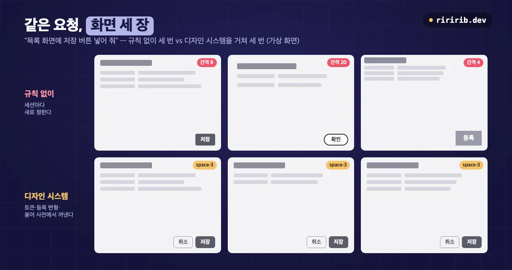
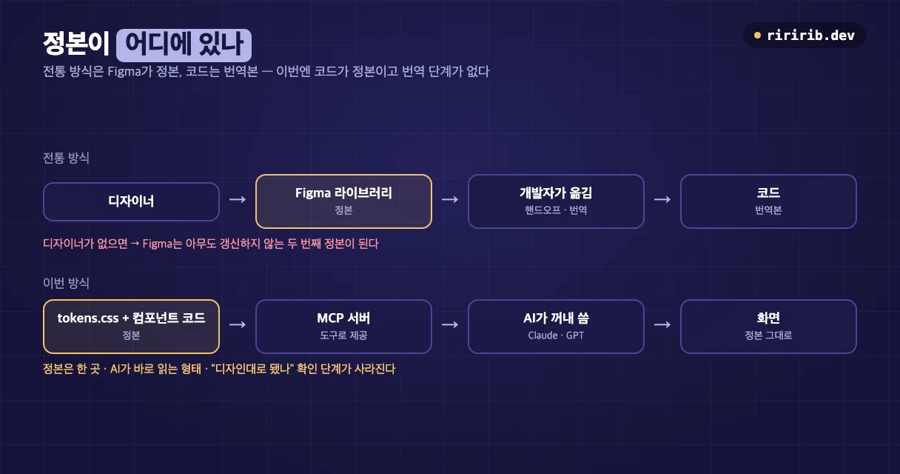
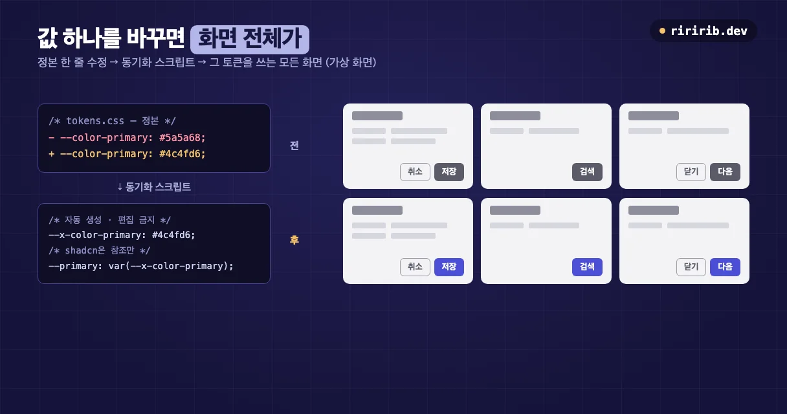
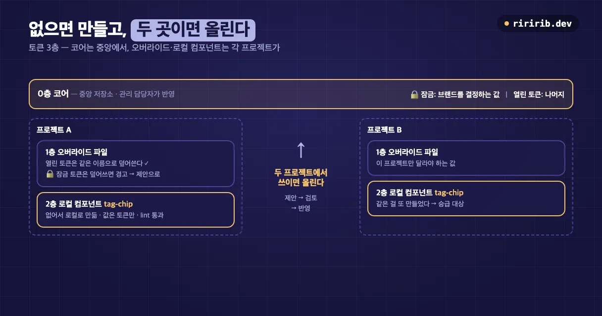
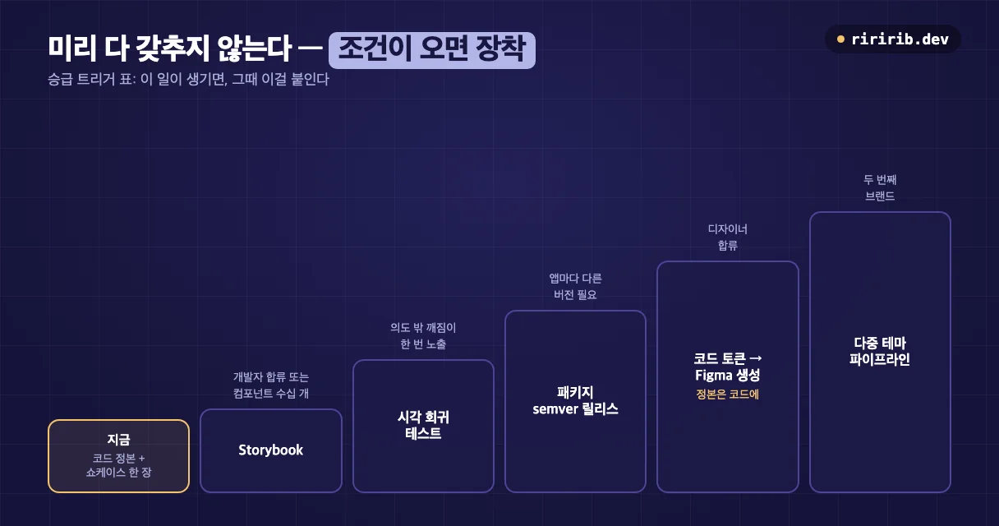

## 문제 — 같은 요청인데 화면이 세 장 다 다르다

AI로 화면을 만들기 시작하고 가장 먼저 부딪힌 건 실력이 아니라 **일관성**이었다.

"목록 화면에 저장 버튼 넣어 줘"를 세 번 요청하면 세 화면이 나온다. 하나는 각진 회색 버튼에 `저장`, 하나는 둥근 테두리 버튼에 `확인`, 하나는 큼직한 사각 버튼에 `등록`. 간격도 8px, 20px, 4px로 제각각이다. 하나씩 보면 전부 그럴듯하다. 모아 놓으면 세 회사가 만든 서비스 같다.


_같은 요청을 세 번. 위는 세션마다 새로 정한 결과, 아래는 디자인 시스템에서 꺼낸 결과다 (가상 화면)._

원인은 단순하다. AI는 **이전 세션에서 무엇을 정했는지 모른다.** 사람 팀이라면 디자이너가 만든 Figma 라이브러리와 "우리 버튼은 이거"라는 암묵지가 이 역할을 한다. 내 작업 환경에는 둘 다 없었다. 디자이너가 없었고, 화면 대부분을 AI가 코드로 바로 만들었다.

그래서 디자인 시스템을 만들기로 했다. 다만 목적이 조금 달랐다. **사람이 보고 따라 하는 가이드가 아니라, AI가 매번 꺼내 쓰는 도구**여야 했다.

## 전통 방식과 무엇이 다른가



전통적인 흐름은 이렇다. 디자이너가 Figma에 컴포넌트와 스타일을 만들고, 개발자가 그걸 보고 코드로 옮긴다. 정본은 Figma이고, 코드는 그 번역본이다.

이 흐름을 그대로 가져오지 않은 이유는 세 가지다.

1. **Figma를 관리할 사람이 없다.** 디자이너가 없는데 Figma를 두면, 아무도 갱신하지 않는 두 번째 정본이 생긴다. 코드와 Figma가 어긋나기 시작하면 AI는 어느 쪽을 믿어야 할지 모른다.
2. **AI가 실제로 읽는 건 코드와 텍스트다.** 화면을 만드는 주체가 AI라면, 정본도 AI가 바로 읽을 수 있는 형태여야 한다.
3. **번역 단계가 없어진다.** 코드가 정본이면 "디자인대로 구현됐나"를 따로 확인할 필요가 없다. 정본이 곧 구현이다.

그래서 **코드 한 곳을 유일한 정본**으로 두고, 처음부터 무겁게 다 갖추지 않고 **가볍게 시작해 조건이 생기면 하나씩 장착**하기로 했다. 이 "조건이 생기면" 부분은 마지막 절의 승급 트리거 표로 정리했다.

## 이렇게 도입했다

### 1. 문서를 AI가 찾기 좋은 구조로

디자인 시스템 문서를 다섯 층으로 나눴다.

| 층 | 내용 |
|---|---|
| 기초 | 색·타이포·간격·그림자 같은 기본값, 그리고 용어 사전 |
| 컴포넌트 | 버튼·입력·카드·테이블 같은 개별 스펙 |
| 패턴 | 폼·검색·빈 상태·오류·로딩 같은 반복 UX 규약 |
| 템플릿 | 페이지 단위 레이아웃 |
| 선택 가이드 | "이럴 땐 어떤 컴포넌트를 쓰나" |

여기에 **키워드 → 문서** 색인 파일을 하나 붙였다. "로그인 화면"이라는 요청이 오면 인증 패턴, 입력 필드, 버튼 문서가 함께 걸리도록. AI가 문서 전체를 읽지 않고 필요한 서너 편만 가져가게 하는 장치다.

### 2. 토큰은 한 파일에서만 흐른다

색·간격·반경 같은 값(디자인 토큰)은 **사람이 고치는 파일을 딱 하나**로 정했다.

```text
tokens.css         ← 정본. 사람이 편집하는 유일한 토큰 파일
    │  동기화 스크립트 (바꿀 때마다 실행)
    ├─→ 앱 A/generated-tokens.css   [자동 생성 · 편집 금지]
    └─→ 앱 B/generated-tokens.css   [자동 생성 · 편집 금지]
```

규칙은 세 줄이다.

- 생성된 파일의 변수에는 전부 공통 접두사(여기선 `--x-`)를 붙인다. 앱이 원래 쓰던 변수와 이름이 부딪히지 않게.
- shadcn 같은 UI 라이브러리의 변수는 값을 갖지 않고 **참조만** 한다.

  ```css
  --primary: var(--x-color-primary);
  ```

- 생성된 파일은 손대지 않는다. 고칠 땐 정본만 고치고 스크립트를 다시 돌린다.


_정본의 값 하나를 바꾸면 그 토큰을 쓰는 화면이 모두 같이 바뀐다 (가상 화면)._

### 3. AI에게 거는 강제 규칙 세 개

문서만 두면 AI는 참고는 해도 지키지는 않는다. 그래서 어기면 안 되는 규칙 세 개를 정본에 박았다.

1. **원시값 금지.** 화면 코드에 `#hex` 색이나 임의의 `px`를 직접 쓰지 않는다. 필요한 토큰이 없으면 토큰부터 추가한다.
2. **등록되지 않은 변형 금지.** 버튼을 정본과 다르게 쓰고 싶으면, 컴포넌트 문서에 변형 이름과 스펙, 왜 필요한지를 먼저 적어 등록하고 쇼케이스에 올린 뒤에 쓴다. AI가 미등록 변형을 요청받으면 만들지 말고 등록부터 제안한다.
3. **용어는 사전에서만.** `저장`/`확인`/`등록`이 섞이는 문제는 색보다 흔하다. 화면 문구는 용어 사전의 정본 표현만 쓴다.

맨 위 그림의 아래 줄이 이 세 규칙을 지킨 결과다.

## 이렇게 쓰고 있다

### MCP 서버 — AI가 디자인 시스템을 도구로 꺼낸다

처음에는 문서를 프로젝트 폴더에 두고 AI가 읽게 했다. 쓰는 프로젝트가 늘자 문제가 생겼다. 프로젝트마다 문서를 복사하면 복사본이 낡는다.

그래서 디자인 시스템을 **별도 저장소로 떼고, MCP 서버로 감쌌다.** MCP(Model Context Protocol)는 AI 도구가 외부 기능을 호출하는 표준 규격이다. 이제 프로젝트는 디자인 시스템 파일을 갖지 않고, 필요할 때 도구로 물어본다.

도구는 역할별로 나눴다.

| 역할 | 언제 | 돌려주는 것 |
|---|---|---|
| 찾기 | UI 요청을 받으면 **가장 먼저** | 참조할 문서와 섹션 |
| 꺼내기 | 컴포넌트·토큰·용어가 필요할 때 | 스펙과 실제 코드, 토큰 값과 잠금 여부, 정본 용어 |
| 검사 | 다 만든 뒤 | 하드코딩된 `#hex`·`px`를 찾아 토큰으로 바꾸라고 제안 |
| 제안 | 없거나 바꿔야 할 때 | 제안서 초안 |
| 버전 | 버전을 고정하거나 올릴 때 | 현재 버전과 변경 기록 |

진입점은 두 개다. Claude Code처럼 로컬에서 붙는 도구는 **stdio**로, ChatGPT처럼 원격으로만 붙는 도구는 **HTTP**로. 같은 서버, 같은 데이터라서 **어느 AI로 화면을 만들어도 같은 규칙**을 따른다.

순서가 중요하다. 찾기 → 꺼내기 → 작성 → 검사. 마지막 검사가 있어서 AI가 규칙을 깜빡해도 하드코딩이 그대로 남지 않는다.

### 토큰 3층과 잠금 토큰

여러 프로젝트가 같이 쓰면 "우리 프로젝트에서는 이 값이 달라야 한다"는 요구가 반드시 나온다. 이걸 막으면 다들 몰래 복사해서 고치고, 다 허용하면 디자인 시스템이 의미가 없어진다. 그래서 층을 나눴다.

| 층 | 어디 | 누가 고치나 | 예 |
|---|---|---|---|
| 0층 코어 | 중앙 저장소의 토큰 정본 | 관리 담당자 | 브랜드를 결정하는 값 |
| 1층 프로젝트 오버라이드 | 프로젝트의 오버라이드 파일 | 그 프로젝트 | 그 프로젝트만 달라야 하는 값 |
| 2층 로컬 컴포넌트 | 프로젝트 안 로컬 폴더 | 그 프로젝트 | 그 화면에만 필요한 위젯 |

그리고 브랜드를 결정하는 일부 토큰에는 **잠금(locked)** 표시를 했다. 이건 1층에서 덮어쓸 수 없고, 덮어쓰면 MCP 도구가 경고한다. 프로젝트마다 바뀌어도 되는 것과 절대 바뀌면 안 되는 것을 **값 옆에 적어 둔 것**이다.

### 없을 때 · 바꿔 쓸 때 · 올릴 때

쓰는 쪽 규칙은 세 상황으로 정리했다.



**없을 때.** 먼저 정말 없는지 검색한다. 이름이 달라 못 찾는 경우가 많다(스낵바와 토스트처럼). 없으면 프로젝트 안 로컬 폴더에 만든다. 이때도 값은 토큰만 쓰고 검사 도구를 돌린다. 새 토큰이 필요하면 1층에 임시로 정의하면서 동시에 제안을 올린다. 채택되면 0층으로 올라가고 임시 정의는 지운다.

**바꿔 쓸 때.** 잠기지 않은 토큰은 오버라이드 파일에서 같은 이름으로 덮어쓴다.

```css
/* 오버라이드 파일 — 이 프로젝트만 표 행 간격을 촘촘하게 */
:root { --x-density-row: 36px; }
```

잠긴 토큰을 바꿔야 한다면 오버라이드가 아니라 제안이다. 컴포넌트 규격을 바꾸고 싶으면 코드를 로컬 폴더로 복사해 **이름을 바꿔서** 고친다. 원본 이름을 덮어쓰지 않는다.

**올릴 때.** 로컬에서 만든 것이 **두 프로젝트 이상에서 쓰이면** 중앙으로 올린다. 제안하고, 검토를 거쳐 반영한다.

한 줄로 줄이면 이렇다.

> 없으면 로컬로 만들고 제안한다 · 열린 토큰은 오버라이드, 잠금 토큰은 제안 · 두 곳에서 쓰이면 올린다.

### 바꿀 때마다 5단계 — 사람 손은 한 번

디자인 시스템 자체를 고칠 때는 매번 같은 다섯 단계를 거친다.

| 단계 | 내용 | 담당 |
|---|---|---|
| ① 수정 | 정본 수정 후 동기화 스크립트 실행 | AI |
| ② 기록 | 변경 기록 + 버전 결정 | AI 작성, 사람 확인 |
| ③ 리포트 | 사용처를 grep해 영향받는 화면 목록 | AI |
| ④ 확인 | 쇼케이스 페이지를 눈으로 점검 | **사람 (유일한 필수 수동 단계)** |
| ⑤ 전파 | 반영 확인, 버전을 고정해 둔 곳은 올릴지 결정 | 사람 결정, AI 실행 |

사람이 반드시 해야 하는 건 ④ 하나다. 나머지는 AI가 하고, 사람은 결정만 한다. 대신 ④는 생략할 수 없다. 색이 미묘하게 어긋나는 건 grep으로도 lint로도 안 잡히고 **눈으로만** 잡힌다.

버전은 semver를 따른다. 기존 화면이 깨질 수 있으면(토큰 이름 변경, 규격 변경, 용어 개편) 앞자리, 추가만 되면 가운데, 값 보정이면 끝자리다. 쓰는 쪽은 버전을 고정해 두고, 앞자리가 바뀌면 변경 기록을 보고 준비된 뒤에 올린다. 중앙이 바뀌어도 준비 안 된 프로젝트가 깨지지 않는다.

여기에 **주기적인 짧은 감사**를 더했다. 원시값 직접 사용, 미등록 변형, 금지 용어, 구버전에 묶인 곳을 찾아서 하나씩 정리한다. 고치든, 정식으로 등록하든, 예외로 남기든 기록은 반드시 한다.

## 앞으로 — 이런 일이 생기면 이걸 붙인다

처음부터 Storybook, 시각 회귀 테스트, Figma 라이브러리를 다 갖출 수도 있었다. 하지만 쓰는 사람이 적을 때 그걸 다 들이면 **유지 비용만 먼저 생긴다.** 그래서 반대로, "언제 붙일지"를 미리 표로 정해 뒀다. 조건이 충족되면 그때 장착한다.


_계단은 순서가 아니라 무게다. 어느 조건이든 먼저 오는 것부터 장착한다._

| 이런 일이 생기면 | 이걸 붙인다 | 그 전까지는 |
|---|---|---|
| 개발자가 합류하거나 컴포넌트가 수십 개로 늘면 | **Storybook** | 쇼케이스 페이지 한 장이 대신한다 |
| 의도하지 않은 디자인 깨짐이 배포·데모에 한 번이라도 노출되면 | **시각 회귀 테스트** (스냅샷 비교) | 사람이 쇼케이스를 눈으로 본다 |
| 앱마다 다른 버전이 필요해지면 | 패키지 **semver 릴리스** | 한 버전을 같이 쓴다 |
| 디자이너가 합류하면 | 코드 토큰에서 **Figma 라이브러리를 생성** | 코드가 유일한 정본이다 |
| 두 번째 브랜드가 생기면 | **다중 테마 파이프라인** | 테마 한 벌을 오버레이로 쓴다 |

눈여겨볼 건 디자이너 줄이다. 디자이너가 합류해도 정본을 Figma로 옮기지 않는다. **코드 토큰에서 Figma를 만들어 준다.** 정본은 여전히 한 곳이고, Figma는 디자이너가 작업하기 위한 사본이다. 처음에 Figma를 버린 이유(두 번째 정본 문제)가 사람이 늘어도 똑같이 유효하기 때문이다.

트리거의 장점은 하나 더 있다. "Storybook 언제 도입해요?"라는 질문에 매번 회의할 필요가 없다. 표가 답한다.

## 사용한 기술

- **디자인 토큰**: 색·간격·반경 같은 디자인 값을 이름 붙인 변수로 관리하는 방식. 여기선 CSS 변수 한 파일을 정본으로 썼다.
- **동기화 스크립트**: 정본 토큰에 접두사를 붙여 쓰는 쪽 파일을 자동 생성하는 셸 스크립트.
- **shadcn/ui**: 코드를 복사해 쓰는 React 컴포넌트 모음. 변수가 토큰을 참조하게 연결했다.
- **MCP 서버(Node)**: stdio와 HTTP 두 진입점으로 Claude와 GPT 계열 도구에 같은 디자인 시스템을 제공.
- **RAG 색인**: 키워드 → 문서 표. AI가 필요한 문서만 골라 읽게 한다.
- **semver**: 깨짐 / 추가 / 보정을 버전 자리로 구분.

> **🧭 기획자·사업자라면**
> - 디자인 시스템은 디자인 산출물이 아니라 **결정을 재사용하는 장치**다. AI가 화면을 만드는 팀일수록 "한 번 정한 걸 다음 세션이 기억하게" 만드는 비용이 품질을 좌우한다.
> - **처음부터 다 갖추지 말고, 붙일 조건을 먼저 합의하라.** 승급 트리거 표는 과투자를 막고, "언제 도입하냐"는 반복 회의를 없앤다.
> - 자동화해도 **사람 확인 한 단계는 남겨라.** 어디가 그 한 단계인지(여기선 쇼케이스 육안 점검)를 명시해 두면, 나머지를 안심하고 AI에 맡길 수 있다.
{: .prompt-tip }

## 정리

- AI에게 화면을 맡기면 문제는 품질보다 **일관성**이다. 해법은 AI가 매번 꺼내 쓰는 단일 정본이다.
- 정본은 **코드 한 파일**, 강제 규칙은 **원시값 금지 · 미등록 변형 금지 · 용어 사전** 셋, 제공은 **MCP 서버**로.
- 도구는 처음부터 다 들이지 말고 **트리거가 생기면 장착**한다. 디자이너가 와도 정본은 코드에 남는다.
