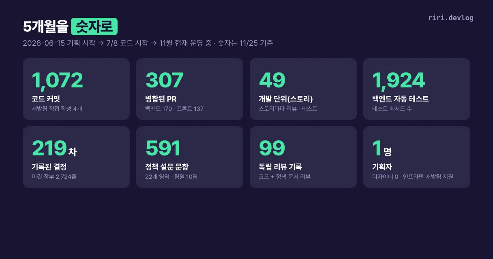
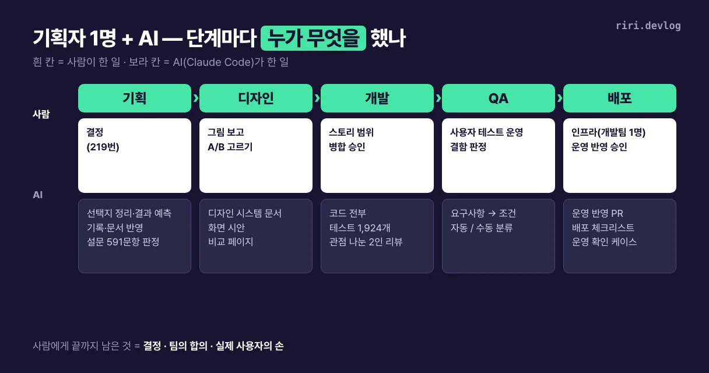

> 무엇을 만들었는지는 밝히지 않는다. 이 시리즈는 **어떻게 만들었나**만 다룬다.
{: .prompt-info }

## 이 시리즈가 다루는 것

6월 중순에 기획 문서 첫 줄을 썼다. 11월 말인 지금은 운영 서버에 올라간 서비스를 매일 고치고 있다.

그동안 팀에 디자이너는 없었다. 코드를 쓰는 개발자도 없었다. **기획자 1명(나)과 Claude Code**가 전부였고, 서버 인프라만 개발팀 1명이 도와줬다. 개발팀이 직접 넣은 커밋 4개와 의존성 자동 갱신 봇을 빼면, 코드는 Claude Code가 썼다.

결과물은 세 덩어리다. 고객이 쓰는 웹, 운영자가 쓰는 어드민, 둘이 함께 부르는 백엔드 API. 11월 25일 기준으로 세어 본 숫자는 이렇다. 커밋과 기록은 지금도 늘고 있다.

| 항목 | 숫자 |
|---|---|
| 기간 | 2026-06-15 기획 시작 → 7/8 코드 시작 → 지금(11월)도 운영 중 |
| 코드 커밋 | 1,072개 (백엔드 587 + 프론트 485). 개발팀 4개 · 의존성 자동 갱신 봇 28개 포함 |
| 병합된 PR | 307개 (백엔드 170 + 프론트 137) |
| 개발 단위(스토리) | 49개 — 스토리 = 한 번에 만들고 검사해 병합하는 기능 한 덩어리 |
| 기록된 결정 | 219차 — 결정마다 번호를 붙여 219번째까지 |
| 정책 설문 | 591문항 · 22개 영역 · 팀원 10명 |
| 독립 리뷰 기록 | 99건 (코드 리뷰 + 정책 문서 리뷰) |
| 백엔드 자동 테스트 | 1,924개 (테스트 메서드 수) |

이 글은 시리즈 전체의 지도다. 기획 → 디자인 → 개발 → QA → 배포, 다섯 단계마다 세 가지를 적었다.

1. 사람이 한 일
2. AI가 한 일
3. 가장 크게 막혔던 것 하나

자세한 방법과 템플릿은 단계별 편에서 다룬다.

## 1. 기획 — 사람은 결정만, AI는 결정 재료와 기록

**사람이 한 일: 결정.** 확정된 결정이 219차까지 쌓였다. 하나하나가 내가 "이걸로 가자"고 답한 것이다.

**AI가 한 일:**
- 결정할 거리를 표로 정리했다.
- 선택지마다 고르면 무슨 일이 생기는지 예측을 붙였다.
- 결정이 나면 기록하고, 그 결정을 관련 문서 전부에 반영했다.

### 막혔던 것 ① — AI는 지난주 결정을 모른다

세션이 바뀌면 AI는 지난주에 정한 걸 모른다. 모른 채로 반대 방향을 그럴듯하게 제안한다. 한 번은 넘어가도, 이게 쌓이면 문서끼리 서로 다른 말을 하기 시작한다.

그래서 **미결 장부**를 만들었다. 결정이 안 된 것과 된 것을 5칸으로 나눠 한 파일에 모은다.

| 칸 | 뜻 | AI가 혼자 돌 때 |
|---|---|---|
| 사용자 결정 대기 | 내가 답해야 하는 것 | 결정 금지 |
| 외부 회신 대기 | 다른 회사·다른 팀 답을 기다리는 것 | 결정 금지 |
| 착수 전 검증 | 확인 없이 만들면 안 되는 것 | 결정 금지 |
| 실무 결정 | 일단 정했지만 최종 승인 전 | 바꾸려면 '변경 제안'으로만 |
| 확정 | 끝난 결정(차수 번호) | **뒤집기 금지** |

장부도 썩는다. 지금 약 2,700줄인데, 이미 해결된 항목이 '외부 회신 대기'에 그대로 남아 있던 걸 뒤늦게 찾아 고친 적이 있다. 장부를 만드는 것만큼 **장부를 감사하는 것**도 일이 된다. → 2편

### 막혔던 것 ② — 팀 정책은 회의로 못 정한다

운영 정책처럼 팀원 의견이 필요한 결정이 쌓여 있었다. 질문으로 풀어 보니 **591문항**이었다. 10명이 회의로 591개를 정하는 건 불가능하다.

그래서 분기형 설문을 만들었다. 앞 답에 따라 다음 질문이 달라진다. 응답은 사람이 읽기 전에 규칙으로 먼저 판정했다.

- 유효 응답이 전원 같음 → **전원 동의**
- 가중 점유율 0.65 이상이고, 그 분야 상위 전문가끼리 이견이 없음 → **결정 권고** (분야마다 그 일을 직접 하는 사람의 답에 가중치를 더 줬다. 가중치 매기는 법은 3편에서)
- 전문가끼리 갈림 → **사람이 결정**
- 질문의 전제 자체에 이의 → **질문부터 다시**
- 유효 응답 3명 미만 → **참고만**

문항마다 AI 의견도 붙였다. 조건은 하나였다. 이미 확정된 결정이나 정책 문서에 근거가 있을 때만 의견을 쓰고, 없으면 정확히 "의견 보류"라고 쓴다. 그럴듯한 의견을 지어내는 순간 설문 전체를 믿을 수 없게 되기 때문이다. → 3편

## 2. 디자인 — 디자이너 없이, 코드가 정본

**사람이 한 일: 고르기.** 비교 페이지에 그림으로 나란히 띄운 쟁점 23개에 하나씩 답했다.

**AI가 한 일:** 디자인 시스템 문서를 쓰고, 화면 시안을 만들고, 비교 페이지를 만들었다. 내가 고른 값은 쓰이는 곳 전부에 반영했다.

### 막혔던 것 — 디자인 시스템 문서끼리 값이 달랐다

같은 요소의 색이나 크기가 문서마다 다르게 적힌 곳이 **14건** 나왔다. 사람 디자이너가 있으면 "원래 의도는 이거"라고 정해 주겠지만, 그럴 사람이 없었다.

그래서 기준을 정했다. **코드가 정본**이다. 문서끼리 다르면 두 값을 그림으로 나란히 띄우고, 내가 눈으로 보고 고른다. 값이 다른 14건을 포함해 정리할 쟁점이 23개였는데, 말로 된 선택지보다 그림 비교가 훨씬 빨랐다. 23개에 한 번에 답했고, 서로 얽힌 6개만 추가 확인을 거쳐 확정했다.

디자인 시스템을 AI가 꺼내 쓰게 만든 구조는 [디자이너 없이 AI가 꺼내 쓰는 디자인 시스템 만들기](/posts/ai-native-design-system/)에 따로 정리했다. 화면기획 형식을 고른 과정은 4편에서 다룬다.

## 3. 개발 — 기획자가 스토리를 쪼개고, AI 둘이 서로 검사

**사람이 한 일:** 스토리 범위를 정했다. 리뷰 판정을 보고 병합을 승인했다.

**AI가 한 일:** 코드와 테스트를 전부 썼다. 그리고 **관점이 다른 리뷰어 둘**이 따로 검사했다.

- 리뷰어 A — 데이터 무결성과 보안만 본다.
- 리뷰어 B — 프론트·백엔드 계약과 화면 정합만 본다.

지적이 나오면 고치고, 같은 리뷰어가 재검증한다. 리뷰 원문은 요약하지 않고 그대로 보관했다. 정책 문서 리뷰까지 합쳐 그렇게 쌓인 게 99건이다.

### 막혔던 것 — 테스트는 전부 통과했는데 핵심이 조용히 깨져 있었다

한 스토리를 리뷰하던 시점에 전체 테스트 387개가 0실패였다. 그런데 리뷰어 A가 "이런 상황이면 어떻게 되나"를 확인하는 테스트를 직접 몇 개 더 짜서 돌려 보니, 특정 조건에서 새로 들어온 데이터가 계속 뒤로 밀려 영영 처리되지 않는 결함이 실제로 재현됐다. 그 스토리가 만들어진 목적이 바로 그 데이터를 빠짐없이 처리하는 것이었다. 기존 테스트는 그 상황을 아예 다루지 않았다.

반대 방향의 실패도 있었다. 리뷰를 의무로 정해 놓고도 몇몇 스토리에서 건너뛴 사실을 나중에 완주 감사를 하다 발견했다. 그 스토리들은 사후 리뷰를 따로 돌렸다. 규칙을 만드는 것만으로는 부족하고, 규칙이 지켜졌는지 세는 장치가 따로 필요했다. → 5편

역할을 나눈 AI 에이전트끼리 일을 주고받게 만든 시행착오는 [Claude Code로 AI 사업팀 만들기 (1)](/posts/ai-business-team-1-subagent-cannot-reply/)에 따로 적었다.

## 4. QA — 기획자가 직접 짠 테스트 설계

**사람이 한 일:** 사용자 테스트를 운영했다. 2차 테스트에서는 팀원 3명이 처음부터 끝까지 완주했고, 나온 문제가 결함인지 아닌지는 내가 판정했다.

**AI가 한 일:** 요구사항에서 테스트 조건을 뽑고, 자동 테스트로 이미 커버되는 것과 사람이 직접 봐야 하는 것을 갈랐다.

### 막혔던 것 — 테스트 문서 자체가 틀렸다

조건을 추가할 때마다 문서 맨 위의 누계를 올렸다. 어느 날 실제 표의 행을 세어 보니 누계와 맞지 않았다. 개정이 수십 번 쌓이는 동안 숫자만 따로 굴러간 것이다.

그 뒤로는 누계를 손으로 올리지 않고 실제 행 수를 세서 대조한다. → 6편

## 5. 배포 — 테스트 서버에서 운영으로

**사람이 한 일:** 인프라 작업(개발팀 1명)과 운영 반영 최종 승인.

**AI가 한 일:** 운영 반영 PR, 배포 순서 체크리스트, 운영에서 확인할 테스트 케이스.

### 막혔던 것 — 내가 만든 안전장치가 급한 수정을 막았다

프론트와 백엔드가 주고받는 API 형식(계약)이 서로 어긋나지 않도록, CI에 두 쪽 명세를 비교하는 '계약 대조' 관문을 걸어 뒀다. 평소에는 이 관문이 한쪽만 바뀌는 사고를 잘 잡았다. 그런데 운영 쪽 급한 수정이 바로 이 관문에 걸려 배포가 멈췄다. 관문은 테스트 서버 기준으로 짜여 있었고, 운영 브랜치는 비교 대상이 달랐다.

안전장치도 환경마다 따로 맞춰야 했다. 다음 운영 반영 뒤에 브랜치별로 비교하도록 고칠 계획이다. → 7편

## 1인 + AI로 되는 것, 안 되는 것

| 구분 | 내용 |
|---|---|
| 되는 것 | 문서, 코드, 테스트, 검사, 기록. 양으로 밀어붙이는 일은 대부분 된다 |
| 안 되는 것 | 결정, 팀의 합의, 실제 사용자의 손. 이 셋은 끝까지 사람이 했다 |
| 새로 생긴 일 | AI가 만든 것을 **검증하는 구조**를 설계하는 일. 장부, 독립 리뷰, 테스트 조건이 전부 여기에 속한다 |

다섯 단계의 '막혔던 것'을 모아 보면 공통점이 하나 있다. AI가 일을 못 해서 막힌 적은 거의 없다. 막힌 건 대부분 **AI가 한 일이 맞는지 확인하는 장치가 없거나, 그 장치 자체가 틀렸을 때**였다.

> **🧭 기획자·사업자라면**
> - 1인 + AI의 병목은 개발 속도가 아니라 **결정 속도**다. 219번의 결정 중 하나라도 미루면 AI도 그 자리에서 멈춘다.
> - AI의 결과물을 확인하는 장치(장부, 독립 리뷰, 테스트 조건)는 처음부터 일정과 예산에 넣는다. 안 넣으면 나중에 감사와 사후 리뷰로 갚는다.
> - 인프라와 보안 권한은 결국 사람이 필요하다. "개발자 0명"보다 "개발자 최소 투입"으로 계획하는 게 현실적이다.
{: .prompt-tip }

## 시리즈 목차

1. **전체 지도 — 기획부터 배포까지 5개월** (이 글)
2. 기획 ① AI가 지난 결정을 뒤집지 않게 — 미결 장부 (예정)
3. 기획 ② 팀 정책 591문항을 설문 하나로 정하기 (예정)
4. 디자인 — 디자이너 없이 화면기획 형식 고르기 (예정)
5. 개발 — 관점을 나눈 2인 AI 리뷰 (예정)
6. QA — 기획자가 직접 짠 테스트 설계 (예정)
7. 배포 — 테스트 서버에서 운영까지 (예정)
